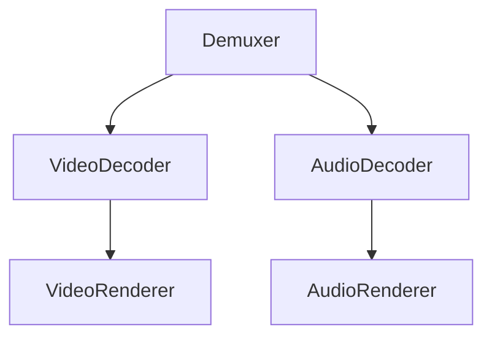

# AI Documentation Rules

> 本文件为按需加载：进入 AI 工作流 Step 4（文档更新计划）时自动加载；其余规范见 `engineering_rules.md`。

## 核心职责

AI 不仅负责编写代码，还必须维护项目知识体系。代码和文档必须同步演进。

禁止：代码更新而文档不更新。

---

# 文档同步原则

重要设计必须有文档，代码和文档必须同步演进。以下情况必须更新文档：新增 / 删除 / 修改模块及其职责；新增 / 修改协议与接口；新增 / 修改数据库结构；引入新依赖；新增设计模式；修改系统架构。

---

# 文档目录规范

```
docs/
├── architecture.md
├── modules.md
├── class_reference.md
├── api.md
├── protocol.md
├── database.md
├── deployment.md
├── troubleshooting.md
├── changelog.md
├── test_hooks.md        # 测试钩子清单（存在钩子时，格式见 testing_rules.md）
└── adr/
```

项目根目录必须有 README.md。

---

# README.md 规范

项目根目录 README 是文档入口，必须包含：

* 项目简介（一句话描述）
* 功能特性列表
* 依赖环境说明
* 构建方式（具体命令）
* 快速启动步骤
* 项目目录结构说明

禁止：

* README 内容与实际代码脱节
* 省略构建步骤导致新人无法运行项目

---

# 文档语言规范

统一规定：

* 文档正文：中文
* 代码注释（公共接口）：中文
* 代码内变量/函数命名：英文
* Git Commit 信息：中文
* API 字段名：英文

禁止中英文混用导致文档风格不一致。

---

# 图表规范

架构图、流程图、时序图必须使用 Mermaid 格式：

* 直接嵌入 Markdown 文件（版本可控）
* 禁止使用截图充当架构图
* 禁止使用无法版本控制的二进制图片文件



发生架构变化时，必须同步更新图表。

---

# 九类文档：内容与更新时机

| 文档 | 记录内容 | 更新时机 |
|------|---------|----------|
| `architecture.md` | 模块划分、调用关系、依赖、数据流、设计思想 | 架构变化时 |
| `modules.md` | 各模块职责、依赖、输入/输出、扩展点 | 新增模块时 |
| `class_reference.md` | 公共类的职责、核心接口、使用示例 | 新增公共类时 |
| `api.md` | 请求参数、返回参数、错误码、调用示例 | 修改接口时 |
| `protocol.md` | 字段、字节序、数据长度、含义、示例 | 修改协议时 |
| `database.md` | 表结构、字段说明、索引、关系 | 结构/字段变更时 |
| `deployment.md` | 环境要求、依赖安装、启动/升级/回滚步骤 | 部署变化时 |
| `troubleshooting.md` | 常见问题：现象、原因、解决方案 | 新增问题时 |
| `changelog.md` | 日期、版本、变更内容、影响范围 | 每次有意义的变更 |

质量要求：

* `class_reference.md` 的代码示例必须是可编译运行的真实代码，禁止伪代码，覆盖典型场景与错误处理

---

> ADR（架构决策记录）完整规范请参阅 `architecture_decision_record.md`

---

# AI修改代码时

必须检查是否需要同步更新文档。如果需要：先列出应更新的文档，再执行修改。

每次输出时必须明确声明：

* 已更新的文档列表
* 不需要更新的文档及原因

禁止代码已变更但文档检查结果为空（视为漏检）。

---

# 文档版本关联规范

文档必须与代码版本保持对应：

* `changelog.md` 必须记录每次有意义的变更
* 重大接口变更必须在 `api.md` 中标注版本号
* ADR 记录的决策不得事后修改，只能新增补充 ADR

禁止：

* 文档版本落后于代码超过一个迭代周期
* 删除历史文档记录（应标注为「已废弃」）

---

# 规则优先级与例外

当文档规则之间存在冲突时：**准确性 > 完整性 > 格式规范**

例外条款：

* 早期原型阶段可暂缓部分文档，但必须在 `changelog.md` 记录欠债
* 紧急修复可先修代码，但必须在下一次提交前补充文档
* 若某类文档确实不适用（如无数据库则无 `database.md`），可跳过，但需在 `architecture.md` 中说明

---

# 文档质量要求

禁止无意义文档、禁止复制代码充当文档。

文档必须帮助：新人理解系统、开发人员扩展系统、运维人员部署系统、测试人员验证系统。

