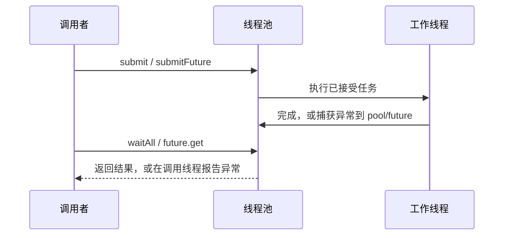

# ADR-002：输入校验与异步任务错误边界

- 日期：2026-10-05
- 状态：已采纳

## 决策

外部数据校验使用返回状态与错误文本，不将不支持的布局默认为成功。标准库分配失败仍按其异常语义传播。
工作线程必须截获用户回调异常：现有 submit 的错误由 waitAll 排空后报告，新增 submitFuture 的错误由对应 future::get 报告。
调用方可直接处理自己的异常类型。析构只负责排空和回收，不抛出任务异常；需要获知结果的调用方必须 waitAll/get。

这明确替代通用语言规则中“禁止跨线程传递异常”的笼统要求：使用 exception_ptr/future 存储错误，异常不会越过线程入口。
禁止吞掉异常但声称成功，也不引入另一套无法保存任意回调异常类型的错误枚举。

## 兼容性

- submit、waitAll、executeSequential、executeParallel 原调用形态保留。原来导致进程终止的错误现在可以被捕获。
- submitFuture 是新增接口，waitAll 只等空闲，不替代其 future::get。多次 fire-and-forget 失败仅保留首个未消费异常。
- sampleChannel 改为返回 bool，忽略返回值的既有调用仍可编译；严格函数指针类型需同步修改。
- 删除 accessorFloats：它不能表达 stride、合法长度、字节序和指针生命周期。迁移到 sr::gltf::AccessorView::create/readFloat。

## 生命周期

读取视图不拥有模型字节；模型必须存活且内容不变。线程任务中的引用必须活到完成。
waitAll 观测的是队列和活动任务同时为空的一刻，不是对未来提交的栅栏。
同一池的 worker 不得调用 waitAll、销毁该池或阻塞等待依赖该池排队任务的 future。
调用方不得在对象析构期间并发访问对象。命令并行执行只适用于不重叠存储或已有同步的命令；不同物体不代表没有 framebuffer 数据竞争。

## 备选方案

统一 noexcept/错误码不能承接 std::function 的任意用户异常；全面把旧 submit 改为 future 又会让原有忽略返回值的调用静默丢失错误。
因此保留旧等待模式，单独添加结果任务接口，在边界分别报告错误。
