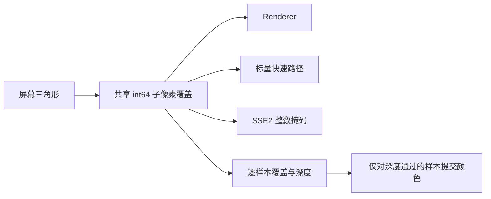

# ADR-003：确定性子像素覆盖与逐样本提交

- 日期：2026-10-06
- 状态：已采纳

## 背景与选择

各光栅化循环使用浮点 >=0，共享边双方都能覆盖。MSAA 示例还以像素中心深度控制颜色写入，
使中心之外的样本只更新深度，或覆盖未通过深度测试的其他样本颜色。

备选 A 是仅为浮点相等增加 top-left 判断；不同遍历起点的舍入误差仍可能形成裂缝。
采用 B：共享 8 位小数子像素覆盖层，int64 增量边方程，拒绝非有限或绝对值超过 2^20 的屏幕坐标。
这个界限使量化坐标绝对值 <=2^28、差值 <=2^29，边式和步进处于 int64 范围内。

屏幕坐标 y 向上；CCW 归一化后 dy<0 或 dy==0 且 dx<0 的边包含等号，其他边减一整数单位。
覆盖偏置不参与深度和属性插值。三角形量化后退化则丢弃。相同量化端点的共享边归属唯一；
不同输入几何形成的 T 结点或不一致裁剪交点不因此自动修复。

保持现有 Renderer/fast 入口，实验 SSE2 仍不承载完整 shader。新增 sr::MSAAFlatRenderer 抽取 stage9 的常量颜色示例逻辑，
不引入第二套通用着色管线。共享覆盖可改变恰好位于边缘的像素，不更新基准图来掩盖变化。
MSAA 样本数约束为 1 或 4；输入缓冲尺寸、样本编号在访问前检查。

## 性能与验证

整数覆盖是正确性选择，不先验声称加速。新增可选、默认关闭的主管线基线目标，输出固定场景的时间分布及像素哈希。
使用既有浮点插值以控制影响范围；后续 tile、顶点缓存等优化需独立测量。
参考 [Microsoft 的三角形与 MSAA 覆盖规则](https://learn.microsoft.com/en-us/windows/win32/direct3d11/d3d10-graphics-programming-guide-rasterizer-stage-rules)，
本项目保留自身 y 向上坐标系及教学用途，不宣称 Direct3D 一致性。
