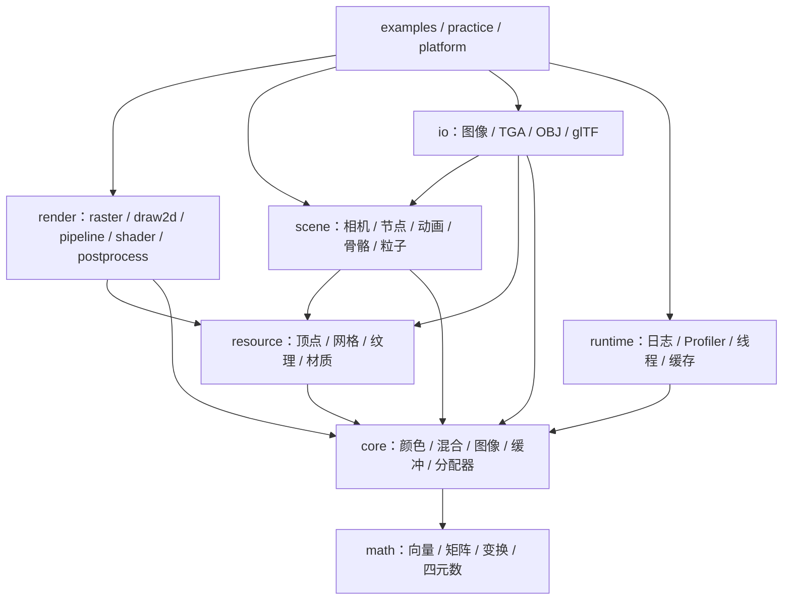

# ADR-004：模块边界、公共 include 与可选组件（2.0 兼容性）

## 背景

SoftRenderer 是 header-only 的教学型软渲染器，`CMakeLists.txt` 提供
`SoftRenderer::softrenderer` 别名与 `find_package(SoftRenderer)` 支持，
「可作为头文件库对外集成」是项目明确卖点。

但当前结构对「对外复用」有三个硬约束未解决：

1. `src/` 是**唯一目录**，公共接口与内部实现混在一起，安装规则直接安装整个 `src/`
   （`cmake/install.cmake`），测试支持头 `tests/support/pixel_regression.h` 也会被一起发布。
2. **单一构建目标** `softrenderer` 通过 INTERFACE 传递 `third_party_impl`（加载器）、
   `sr_entt`（ECS）与 `Threads::Threads`。只想用纯渲染的下游，也会被动获得
   文件解析器、ECS 框架与线程依赖。
3. 职责归属混乱：`core/` 同时容纳缓冲区、后处理、线程池、图像文件读写与基准框架；
   纹理直接依赖 TGA 读写；动画采样直接依赖 tinygltf 的 `Model` 与 accessor。

## 问题

如何在不牺牲「数学与绘制可单独按头文件使用」的前提下，让下游按需取用组件，
并让目录、头文件依赖与构建目标三者的边界一致？

## 备选方案

### 方案 A：保留现有 `src/` 公共头布局，仅在内部调整归属

- 优点：改动面小，仓库内引用改动少，短期可完成
- 缺点：公共与内部实现继续同目录共享，安装仍需安装整个 `src/`；
  无法表达「纯渲染不依赖加载器」这一边界；组件化依赖无从验证

### 方案 B：公共 `include/` + 私有 `src/` + 可选组件

- 公共接口集中到 `include/softrenderer/`，是唯一正式 include 入口
- 文件加载实现编译进可选静态库 `src/io/`，第三方头只对实现可见
- 纯算法保留头文件（INTERFACE）形式
- 优点：公共边界、模块依赖与组件闭包都可被编译与安装测试验证；
  「纯 render 不可见 io/runtime/platform/第三方头」成为可断言的规则
- 缺点：需要同步改造安装规则与消费工程；仓库内全部 include 路径与命名空间要一次性更新

### 方案 C：只拆构建目标，不改目录与命名空间

- 优点：改动最小
- 缺点：目录与头文件依赖仍无法反映模块边界，「找缓冲/找绘制/找加载」仍需翻找

## 最终方案

**方案 B：公共 `include/` + 私有 `src/` + 可选组件。**

分层与依赖方向（只允许自上而下）：

| 模块 | 允许依赖 |
|---|---|
| math | 标准库数学与基础类型 |
| core | math；不含文件、日志、线程或第三方依赖 |
| resource | core、math；只管理内存中的资源 |
| render | resource、core、math；不依赖 scene、io、runtime、platform |
| scene | resource、core、math；不依赖加载器或窗口 |
| io | scene、resource、core；第三方解析器仅私有可见 |
| runtime | core、标准库宿主能力；通过回调使用其他模块 |
| platform、应用 | 按实际用途组合上述模块 |

## 选择原因

1. **边界必须可机械验证**。方案 A/C 下「纯渲染不依赖加载器」只是文档约定；
   方案 B 下它是一条可写成测试的 include 白名单规则，与
   `engineering_rules.md` 的平台隔离红线同性质。
2. **依赖闭包决定下游成本**。当前只想画三角形的下游被迫引入 tinygltf/nlohmann/EnTT/线程；
   组件化后 `find_package(SoftRenderer COMPONENTS core)` 不需要查找 Threads。
3. **安装内容应当等价于公共接口**。方案 B 后安装产物只含公共头与实现库，
   不再包含测试支持与基准框架。
4. **可分批验证**。每个批次（基础层、渲染层、场景与加载、发布验收）单独构建并
   跑测试与像素回归，出问题能定位到批次。

## 影响范围

* `include/softrenderer/`：新增公共头根目录，公共类统一归 `sr`，
  功能函数归 `sr::draw2d` / `sr::postprocess` / `sr::raster` / `sr::animation` / `sr::io`
* `src/io/`：加载器实现、私有转换器与第三方实现单元
* `cmake/targets.cmake`（新增）：组件目标定义；`cmake/install.cmake` 改为按组件导出
* 新增构建开关：`SR_BUILD_IO`、`SR_BUILD_RUNTIME`、`SR_ENABLE_ENTT`（默认 ON）
* **API Break**：旧头文件路径与全局类型名不再保留转发或别名，版本 `1.0.0` → `2.0.0`

### 版本号处理

`cpp_project_rules.md` 禁止在同一大版本内删除公共接口。本次统一调整头文件路径与
命名空间构成 API Break，且持续时间跨越多个批次，故**一次性升 2.0.0**，
避免为每批迁移反复改版本号。项目当前无外部使用者，`VERSION` 仅用于生成版本头，
升级成本仅体现为仓库内与消费测试的同步更新。

## 失效条件

* 若本项目改为编译型静态库/动态库（符号不再进入使用者编译单元），
  命名冲突与传递依赖风险大幅降低，应重新评估是否继续拆分组件
* 若确定永不对外集成（仅作教学示例集合），可退回方案 A，本 ADR 应标记为「已替代」

## 状态

已采纳（2026-10-23）—— 阶段 1–4 已完成，阶段 5 部分完成，见 `docs/tasks/TASK-014`

## 补充：组件化导出（2.0.0 已落地）

* 组件目标：`SoftRenderer::core`（math/core/resource）、`::render`、`::scene`、`::io`（STATIC）、`::runtime`、可选 `::entt`；
  `SoftRenderer::softrenderer` 作为已启用组件的聚合目标。
* 开关：`SR_BUILD_IO` / `SR_BUILD_RUNTIME` / `SR_ENABLE_ENTT`（默认 ON）；三者关闭时只配置核心库，
  不查找 Threads、不编译加载器；缺失组件时示例/练习/测试及其依赖的示例会被跳过并报告原因。
* 依赖闭包：`find_package(SoftRenderer COMPONENTS core)` 只导入 core 及其依赖，即使安装包内存在
  io/runtime 也不查找 Threads；请求未构建的组件时 `check_required_components` 报错。
* 安装边界：只装 `include/softrenderer/` 公共头与组件目标；第三方解析器头（stb/tinyobj/tinygltf/nlohmann）
  不安装，`src/io/` 私有实现头不安装；EnTT 头仅随可选适配组件安装。
* 门禁（不靠人工审查）：`tests/architecture/check_boundaries.cmake` 的 include 白名单、
  `public_headers_check` 逐个公共头独立编译、`namespace_sentinel` 全局名冲突哨兵，均由 CTest 执行。
* 已知未完成：覆盖率本地实测与 macOS/Linux 远端 CI 结果（需真实运行后报告）。

## 补充：命名空间全面收敛与测试拆分（2.0.0 收尾）

* **全部公共符号归 `sr`**：27 个仍含全局声明的公共头（framebuffer/depthbuffer/blend、math 五个、
  renderer/renderer2d、clip/render_queue、shader/surface_shader/varyings、triangle、
  shaders/advanced_shaders/pbr_shader、cubemap/mesh/texture/vertex、camera/camera2d、
  particle_system/skeleton）包进 `namespace sr`；`Color` 一并迁移；
  `sr_log_init/sr_log_shutdown` → `sr::logInit` / `sr::logShutdown`；
  `namespace raster_fast` → `sr::raster`。**不保留别名桥与旧头文件转发**（破坏性变更，语义为 2.0）。
* **头文件内部不使用 using-directive**：公共头各自独立可编译，不依赖 include 顺序；
  应用侧（examples/tests/benchmarks/practice）统一 `using namespace sr;`。
* **门禁**：`namespace_sentinel.cpp` 先全局声明 60 个同名类型（Framebuffer/Mesh/Texture/
  Camera/Renderer/Shader/Varyings/Material/SceneNode/Position/GBuffer/Mat4/Log …），
  再包含全部公共头，并 `static_assert` 锁定 `sr::Framebuffer`、`sr::Mesh`、`sr::Texture`。
  回归全局命名空间或改用 `using sr::X;` 都会编译失败。
* **测试拆分**：`test_core.cpp`（1468 行）→ 10 个模块级文件，`tests/CMakeLists.txt` 显式列源文件；
  ECS 哨兵类型移入 `namespace ecsCanary`，使测试可用 using-directive。
* **实测**：构建 0/0；`unit_tests` 179/179；`render_regression` 3/3；20 个离屏示例退出码 0；
  25 个可执行目标；`ctest -L packaging` 3/3。