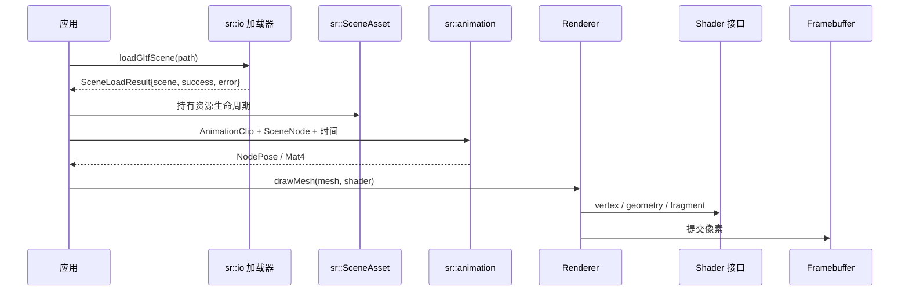
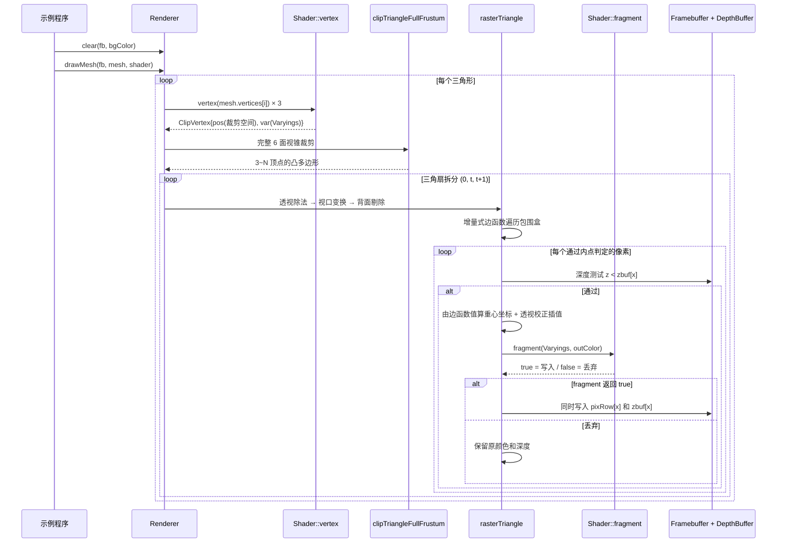
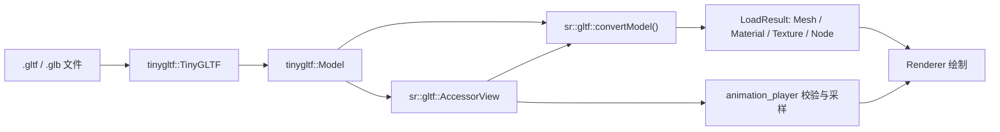
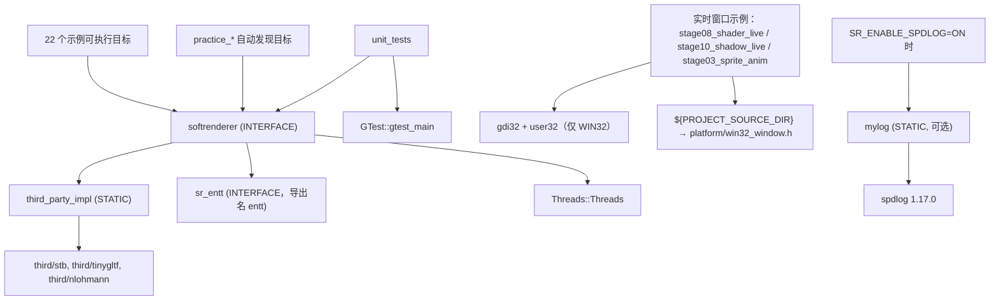

# SoftRenderer 架构

> 本文件描述模块划分、依赖方向、数据流与设计思想。
> 各模块的具体职责、输入输出与扩展点见 [`modules.md`](modules.md)。
>
> 依赖关系以 `tests/architecture/check_boundaries.cmake` 的 include 白名单为门禁，非推测。

## 零、2.0.0 现状（先读这一节）

2.0.0 起公共头唯一入口是 `include/softrenderer/`，`src/` 只保留 `src/io/` 私有实现；
旧路径（`src/raster`、`src/scene`、`src/shader`、`src/core`）已不存在，文中若出现即为历史描述。

| 组件目标 | 包含的公共头 | 允许依赖 |
| --- | --- | --- |
| `SoftRenderer::core` | `math/` `core/` `resource/` | 标准库 |
| `SoftRenderer::render` | `render/{raster,draw2d,pipeline,shader,postprocess}/` | core |
| `SoftRenderer::scene` | `scene/` | core |
| `SoftRenderer::io`（STATIC） | `io/` 声明 + `src/io/` 实现 | scene / core；第三方解析器仅私有 |
| `SoftRenderer::runtime` | `runtime/` | core + 宿主线程 |
| `SoftRenderer::entt`（可选） | EnTT 适配 | 无 |
| `SoftRenderer::softrenderer` | 已启用组件的聚合 | 以上全部 |

边界事实（已实测，由门禁测试固定）：

- `core/` 只包含 `math/` 与同目录头——没有文件系统、日志、线程或第三方依赖。
- `render/` 不包含 `scene/`、`io/`、`runtime/`、`platform/`——因此绘制不需要加载器、线程或窗口。
- `scene/` 不包含 `io/`、`runtime/`、`platform/`——相机、节点、动画采样与文件格式无关。
- 公共头不出现 `tiny_gltf.h` / `tiny_obj_loader.h` / `stb_*` / `json.hpp`；这些只在 `src/io/` 实现单元可见。
- 关闭 `SR_BUILD_IO` / `SR_BUILD_RUNTIME` / `SR_ENABLE_ENTT` 时只配置核心库（不查找 Threads、不编译加载器）。
- **命名空间**：全部公共符号位于 `sr`（功能函数进 `sr::draw2d` / `sr::raster` / `sr::postprocess` /
  `sr::animation` / `sr::io` 等），全局命名空间不再有本库的类型；详见第五节。
- **测试布局**：单测按模块分组（`tests/unit/*_test.cpp`，一文件一模块），
  `tests/architecture/` 放三道编译期门禁，`tests/integration/` 放像素回归与三类外部消费工程
  （聚合 / core-only / render-only，均同时跑 `add_subdirectory` 与安装后 `find_package`）。

数据流（2.0.0）：




## 一、设计定位

SoftRenderer 是**教学型软件渲染器**，两条设计约束优先级最高：

1. **可读性优先于性能**：每个渲染阶段都要能被单独读懂，因此宁可用清晰的
   标量代码，也不做过度的模板元编程或激进的 SIMD 化。
2. **核心计算与平台后端隔离**：数学、光栅化不依赖窗口或图形 API；
   资源加载依赖 stb/tinygltf/tinyobjloader，ECS 使用 EnTT。完整库以头文件为主，
   同时链接资源实现静态库；不能将整个 `src/` 称作零第三方依赖。

这两条约束解释了项目中若干看似「不够优化」的选择，详见「六、已知架构权衡」。

覆盖与属性插值分离：`render/raster/coverage.h` 提供确定性的 top-left 子像素覆盖，供基础填充、Renderer、标量/SSE2 与 MSAA 共用；MSAA 示例算法提取到 `render/pipeline/msaa_renderer.h`。设计见 [ADR-003](adr/ADR-003-raster-coverage.md)，实测见[性能基线](engineering/58-覆盖规则与性能基线.md)。

## 二、分层结构

```mermaid
graph TD
    subgraph L4["使用层（平台相关，仅此处可见 Win32）"]
        EX["examples/ 22 个示例"]
        PR["practice/ 练习程序"]
        PLAT["platform/win32_window.h"]
    end

    subgraph L3["include/softrenderer 公共头 + src/ 待迁移层（平台无关）"]
        RASTER["render/raster 与 src/raster 光栅化与渲染器"]
        SHADER["render/shader 与 src/shader 可编程着色管线"]
        SCENE["scene 与 src/scene 场景资源与加载"]
        IO["io/ 图像与模型文件读写"]
        RUNTIME["runtime/ 日志、线程与缓存"]
        CORE["core/ 缓冲与基础设施"]
        MATH["math/ 数学库"]
    end

    subgraph L2["第三方（third/，源码内嵌）"]
        TGLTF["tinygltf + nlohmann/json"]
        TOBJ["tinyobjloader"]
        STB["stb_image / stb_image_write"]
        ENTT["EnTT"]
        SPDLOG["spdlog（可选）"]
    end

    EX --> RASTER
    EX --> SCENE
    EX -.仅实时窗口示例.-> PLAT
    PR --> RASTER

    RASTER --> SHADER
    RASTER --> CORE
    RASTER --> SCENE
    SHADER --> SCENE
    SHADER --> CORE
    SCENE --> CORE
    SCENE --> MATH
    CORE --> MATH

    SCENE -.gltf_loader.h / animation_player.h.-> TGLTF
    SCENE -.obj_loader.h.-> TOBJ
    IO -.image_write.h / tga.h.-> STB
    EX -.components.h + ECS 用法.-> ENTT
    RUNTIME -.runtime/log.h，仅 SR_USE_SPDLOG.-> SPDLOG
```

**分层规则（红线，见 `.qoder/rules/engineering_rules.md`）**：

- 箭头只能自上而下。公共头（`include/softrenderer/`）与 `src/` 中**任何文件都不得**
  `#include <windows.h>` 或引用 Win32 API
- 正式 include 入口为 `include/softrenderer/`，用法 `<softrenderer/core/framebuffer.h>`；
  阶段 2~5 迁移期间 `src/` 仍提供尚未迁移的渲染与场景头（详见 [TASK-015](tasks/TASK-015-基础层与公共入口.md)）
- `platform/` 不属于渲染器本体，只对需要开窗的示例可见
- 虚线为**条件/局部**依赖：第三方头文件仅在少数几个头文件中出现，且多数受宏保护

## 三、模块依赖明细

实测的完整依赖边（`A -> B` 表示 A include B）：

### include/softrenderer/math/（最底层，无外部依赖）

```
vec.h          → （叶子，仅标准库）
mat4.h         → vec.h
mat3.h         → mat4.h, vec.h
quat.h         → vec.h, mat4.h
rect.h         → vec.h
transform.h    → mat4.h
transform2d.h  → mat3.h, rect.h
```

`math/` 内部**无循环依赖**，`vec.h` 是唯一叶子。

> `transform2d.h` 独立于 `transform.h`，是为了让 3D 投影（`transform.h` 只依赖 `mat4.h`）
> 不被 2D 所需的 `mat3.h` / `rect.h` 污染依赖面。

### include/softrenderer 的 core/ + io/ + runtime/（依赖 math/，io 可选依赖第三方）

```
# core/
color.h              → （叶子）
pixel_format.h       → color.h                       （存储格式：Color565 / Gray8）
depthbuffer.h        → （叶子）
framebuffer.h        → color.h                       （BasicFramebuffer<PixelT> + Framebuffer 别名）
framebuffer_convert.h→ framebuffer.h                 （convertFramebuffer / NearestUpscaler）
blend.h              → color.h
msaa_framebuffer.h   → color.h, depthbuffer.h
float_framebuffer.h  → color.h, depthbuffer.h, framebuffer.h, math/vec.h
gbuffer.h            → math/vec.h, float_framebuffer.h
arena.h              → （叶子）

# io/（公共入口；解析器实现与第三方类型留在 src/io/ 私有）
tga.h                → core/framebuffer.h, core/image.h
image_write.h        → core/framebuffer.h        （实现依赖 stb_image_write）
image_loader.h       → core/image.h
obj_loader.h         → resource/mesh.h
gltf_loader.h        → resource/mesh.h, scene/scene_asset.h

# runtime/
log.h                → （内置模式只用标准库；定义 SR_USE_SPDLOG 时才另接 spdlog）
profiler.h           → （叶子）
resource_cache.h     → （叶子，模板 + std::function）
thread_pool.h        → （叶子，线程池）
command_buffer.h     → （叶子，线程池）

# render/postprocess/
post_processing.h    → color.h, framebuffer.h, float_framebuffer.h, math/mat4.h, math/vec.h

# benchmarks/support/（基准测试支撑，不属公共头）
benchmark.h          → （仅标准库）
```

> ⚠️ **`core/` 并非严格的最底层**：`gbuffer.h`、`float_framebuffer.h` 都依赖 `math/`，
> `render/postprocess/post_processing.h` 还依赖 `float_framebuffer.h`。真实最底层是 `math/` +
> `core/color.h` + `core/depthbuffer.h`。
>
> **已修正的过时描述**：旧文档称 `benchmarks/support/benchmark.h` 反向依赖 `render/raster/rasterizer_fast.h`，
> 实测该头只依赖标准库（`<chrono>` / `<cstdio>` / `<functional>` / `<string>` / `<vector>`），
> 不存在 `benchmarks/ → render/` 的层次倒置。

### resource/ + scene/（依赖 core/ + math/）

```
# resource/
vertex.h            → math/vec.h
mesh.h              → math/vec.h, resource/vertex.h
texture.h           → core/image.h, math/vec.h
cubemap.h           → math/vec.h, resource/texture.h
mesh_generator.h    → resource/mesh.h
texture_generator.h → core/image.h, math/vec.h

# scene/
components.h        → math/vec.h
material.h          → math/vec.h
scene_node.h        → math/mat4.h, math/quat.h, math/vec.h
animation_clip.h    → math/vec.h
keyframe_animation.h→ math/mat4.h, math/vec.h
animation_player.h  → math/mat4.h, math/quat.h, math/vec.h, scene/animation_clip.h, scene/scene_node.h
skeleton.h          → math/mat4.h, math/vec.h
skin.h              → math/mat4.h
camera.h            → math/mat3.h, math/rect.h, math/transform.h
camera2d.h          → math/mat3.h, math/rect.h, math/vec.h
particle_system.h   → math/vec.h, core/color.h
scene_asset.h       → resource/mesh.h, resource/texture.h, scene/animation_clip.h, scene/material.h,
                      scene/scene_node.h, scene/skin.h

# render/pipeline/
render_queue.h      → math/vec.h

# src/io/（私有，随组件实现编译，不安装）
gltf_accessor.h     → tiny_gltf.h（非拥有字节视图）
gltf_mesh.h         → src/io/gltf_accessor.h, resource/mesh.h
```

> ✅ **第三方解析器不外露**：`io/` 的公共头（`gltf_loader.h` / `obj_loader.h` / `image_loader.h`）
> 只暴露 `sr::io` 的接口与 `resource/` / `scene/` 的公共类型，不 include `tinygltf.h` /
> `tiny_obj_loader.h` / `stb_image.h`。解析器实现与相关类型收在 `third_party_impl` +
> `src/io/`（`softrenderer_io` 把 third 头作为 **PRIVATE** include），因此下游只需 `-I include`。

### render/pipeline/ + render/shader/（着色器契约与内置实现）

```
# render/pipeline/
varyings.h          → math/vec.h
shader.h            → render/pipeline/varyings.h, resource/vertex.h
surface_shader.h    → math/mat4.h, math/vec.h, render/pipeline/shader.h, resource/texture.h

# render/shader/
shaders.h           → render/pipeline/surface_shader.h
advanced_shaders.h  → core/depthbuffer.h, render/shader/shaders.h
pbr_shader.h        → math/scalar.h, resource/cubemap.h, render/pipeline/surface_shader.h
deferred_lighting.h → core/gbuffer.h, math/scalar.h
```

`shader.h` 定义 `Shader` 抽象（`vertex` / `geometry` / `fragment` 三段回调）
与 `Varyings`（跨阶段插值数据），是整个可编程管线的契约中心。

### render/raster/ + render/pipeline/ + render/draw2d/（3D 光栅化与 2D 图元）

```
# render/raster/
coverage.h        → math/vec.h
triangle.h        → core/framebuffer.h, math/barycentric.h, math/vec.h, render/raster/coverage.h
rasterizer_fast.h → core/depthbuffer.h, core/framebuffer.h, math/vec.h, render/raster/coverage.h

# render/pipeline/
clip.h            → render/pipeline/varyings.h      （只依赖 Varyings，不再连带网格与纹理）
renderer.h        → core/depthbuffer.h, core/framebuffer.h, math/transform.h, resource/mesh.h,
                    render/pipeline/clip.h, render/pipeline/shader.h,
                    render/raster/coverage.h, render/raster/triangle.h
msaa_renderer.h   → core/framebuffer.h, core/msaa_framebuffer.h, math/barycentric.h,
                    render/raster/coverage.h, render/raster/triangle.h
render_queue.h    → math/vec.h

# render/draw2d/
shape2d.h         → core/blend.h, core/framebuffer.h, math/vec.h
blit2d.h          → core/blend.h, core/framebuffer.h, core/image.h, math/mat3.h, math/rect.h,
                    render/draw2d/shape2d.h, resource/texture.h
renderer2d.h      → core/blend.h, core/framebuffer.h, core/image.h, math/mat3.h, math/rect.h,
                    render/draw2d/blit2d.h, render/draw2d/shape2d.h, resource/texture.h
```

> ℹ️ **`clip.h` 的依赖已收敛**：`ClipVertex` 内嵌 `Varyings`，而 `varyings.h` 只依赖
> `math/vec.h`，因此 include `clip.h` 不再连带拉入网格与纹理。`renderer.h` 直接依赖
> `resource/mesh.h`（需要 `Mesh`），这是它依赖面最宽的一项。

**3D 与 2D 的共享面**：`sr::fillTriangle*`（`render/raster/triangle.h`）与
`sr::draw2d::*`（`render/draw2d/shape2d.h`）同处 `namespace sr` 体系下，但**互不 include**；
两者共用的只有 `core/framebuffer.h` 的写入接口。全部符号均在 `sr` 内，不存在全局符号
（由 `tests/architecture/namespace_sentinel.cpp` 锁定）。

## 四、核心数据流

### 3D 渲染一帧（`Renderer::drawMesh`，`include/softrenderer/render/pipeline/renderer.h`）



**关键实现细节**：`rasterTriangle` 的内层循环使用 `fb.row(y)` / `zbuf_.row(y)`
**行指针直写**，绕过 `setPixel` / `testAndSet` 的逐像素边界检查。安全性由包围盒
预先 clamp 到 `[0, width-1] × [0, height-1]` 保证（`renderer.h` 第 102-108 行）。
这是一个**必须保持的契约**：任何修改包围盒计算或行指针用法的改动，都要重新确认
clamp 仍然生效。

### 2D 渲染（`Renderer2D`，`include/softrenderer/render/draw2d/renderer2d.h`）


`plotBlend` 是 2D 子系统**唯一的像素写入出口**，统一处理：边界裁剪 → BlendMode
混合 → 可选 scissor。短路优化规则：仅 `Opaque`，或（`a == 255` 且模式为
`AlphaBlend` / `Premultiplied`）时才直接覆盖；`Additive` / `Multiply` 不短路。

文字与精灵绘制缓存 `deviceTransform`，避免逐像素做矩阵乘法。

### glTF 加载链路



加载错误不返回半成品；动画失败不修改输出；普通任务错误由 waitAll 报告，结果任务由 future::get 报告。接口生命周期与兼容性见 [ADR-002](adr/ADR-002-data-and-task-errors.md)。

### 实现单元分工（文件名即实现，不再有歧义）

第三方库都是"头文件即实现"，每种 `*_IMPLEMENTATION` 宏在全程序只能定义一次。
2.0.0 把它们收敛为 **三个** 实现单元，均位于 `src/io/` 并编入 `third_party_impl` 静态库：

| 实现单元 | `#define` | 提供的符号 |
| --- | --- | --- |
| `src/io/stb_impl.cpp` | `STB_IMAGE_IMPLEMENTATION`、`STB_IMAGE_WRITE_IMPLEMENTATION` | **stb_image + stb_image_write** |
| `src/io/tinygltf_impl.cpp` | `TINYGLTF_IMPLEMENTATION` | **tinygltf** |
| `src/io/tinyobj_impl.cpp` | `TINYOBJLOADER_IMPLEMENTATION` | **tinyobjloader** |

要点：

- **文件名与内容一致**：历史上有过 `third/tinygltf/tiny_gltf_impl.cpp` 实际只包含 stb 实现、
  `src/scene/gltf_loader_impl.cpp` 才包含 tinygltf 实现的错位，已在本轮整理掉。
- **实现单元全部在 `src/io/`**：`third/` 只放 vendored 源码与许可证，不再放项目编写的包装单元。
- **宏只定义一次**：任何新增实现单元必须并入 `third_party_impl`，不得在其它 TU 重复定义。
- **头不安装**：`third/` 与 `src/io/` 全部不进入安装产物（`consumer_installed` 用例断言）。

## 五、命名空间（2.0.0 已完全收敛）

全部公共符号位于 `sr`；全局命名空间不再有本库的任何类型、枚举或自由函数。

| 命名空间 | 内容 |
| --- | --- |
| `sr` | 公共类与结构体：`Framebuffer`/`DepthBuffer`/`Color`/`Image`/`GBuffer`/`FloatFramebuffer`/`MSAAFramebuffer`、`Renderer`/`Renderer2D`/`Shader`/`SurfaceShader`/`Varyings`/`Vertex`/`ClipVertex`、`Mesh`/`Texture`/`Cubemap`、`Camera`/`Camera2D`/`Material`/`SceneNode`/`SceneAsset`/`Skin`/`Skeleton`/`Bone`/`Particle`、`Mat3`/`Mat4`/`Quat`/`Rect`/`Vec2f`/`Vec3f`/`Vec4f`；`ArenaAllocator`/`Log`/`Profiler`/`ResourceCache`/`ThreadPool`/`CommandBuffer` |
| `sr::draw2d` | 2D 图元、位图合成、`Renderer2D` |
| `sr::raster` | 快速 / 增量 / SIMD 光栅化（`rasterizer_fast.h`） |
| `sr::postprocess` | FXAA、HDR/Bloom、SSAO 等后处理自由函数 |
| `sr::animation` | 动画采样（`NodePose` / `sampleChannel` / `sampleAnimation`） |
| `sr::keyframe` | `skeleton.h` 的简化欧拉角关键帧动画 |
| `sr::io` | TGA / 图像 / OBJ / glTF 的加载与写出 |
| `sr::colors` / `sr::transform` / `sr::meshgen` / `sr::texgen` | 颜色常量、投影变换、程序化网格与纹理 |

正式用法：

```cpp
#include <softrenderer/core/framebuffer.h>

sr::Framebuffer fb(640, 480);
sr::draw2d::fillRect(fb, 10, 10, 40, 20);   // 2D 图元
sr::io::writeTga("out.tga", img);           // 文件读写
```

应用侧（`examples/`、`tests/`、`benchmarks/`、`practice/`）统一 `using namespace sr;`
简化书写；**库头文件内部不使用 using-directive**，因此公共头之间不依赖 include 顺序。

### 门禁：命名空间哨兵

`tests/architecture/namespace_sentinel.cpp` 先在全局作用域声明 `Framebuffer`、`Mesh`、
`Texture`、`Camera`、`Camera2D`、`Renderer`、`Shader`、`Varyings`、`Material`、
`SceneNode`、`Position`、`GBuffer`、`Mat4`、`Log` 等 60 个同名类型，再包含**全部**公共头，
并用 `static_assert` 确认这些类型确实位于 `sr`。

- 任何把符号放回全局命名空间的改动 → 重定义编译错误；
- 任何改用 `using sr::X;` 别名桥的改动 → 同样编译失败（using 声明仍注入全局）。

### 历史

ADR-001 记录收敛策略（按引用面分批、拒绝别名桥），ADR-004 记录 2.0.0 的最终落地：
45 个全局类型与 14 个全局子命名空间全部迁移完毕，未保留任何旧头文件转发。
原 `tests/unit/test_core.cpp` 的编译期哨兵已升级为上面独立编译的哨兵单元
（TASK-006 测试拆分 + TASK-007 命名空间收敛同时完成）。

## 六、已知架构权衡

### 6.1 `rasterizer_fast.h` 未接入主渲染链路

`raster::fillTriangleFast`（增量边函数 + SSE2 四像素并行）**从未被
`Renderer` 调用**，全仓引用只有 `benchmarks/support/benchmark.h` 与单元测试。

不接入的理由：

1. **像素写入路径反而更慢**：`rasterizer_fast.h` 逐像素调用
   `zb.testAndSet(x,y,z)` + `fb.setPixel(x,y,color)`，两者各做一次边界检查；
   而 `renderer.h` 用行指针直写，完全免除边界检查
2. **接口能力不足**：只接受单一 `Color`，不支持 `Varyings` 插值与
   `Shader::fragment` 回调，无法承载完整着色管线

接入需要同时改造这两点，属架构级变更，需先立 ADR。当前定位为
**技术验证 / 基准测试用光栅化器**。

### 6.2 日志双模式：内置模式已改为类型安全的变参模板

`runtime/log.h` 有两种模式，**占位符语法统一为 fmt 风格的 `{}`**：

| 模式 | 触发条件 | 实现 |
| --- | --- | --- |
| spdlog | 定义 `SR_USE_SPDLOG` 且链接 `mylog` | `LOGS_WARN(...)` → fmt 格式化 |
| 内置 | 默认 | `sr::formatLog`（变参模板 + `std::ostringstream`）→ 单个 `%s` 输出 |

**哪些目标走哪条路径**（CMake 中只有调了 `sr_enable_logging()` 的目标才启用 spdlog）：

| 目标 | 模式 |
| --- | --- |
| `stage08_shader_live`、`stage10_shadow_live`、全部 `practice_*` | spdlog |
| **`unit_tests`**、其余 20 个示例 | 内置 |

→ **内置模式是常用路径，不是罕见兜底**。这个事实是下面重构的依据。

#### 旧实现的三个缺陷（已修）

旧版 `sr::Log::log` 是真正的 C 可变参函数（`const char* fmt, ...` + `va_list` + `vfprintf`）：

| # | 缺陷 | 发现方式 |
| --- | --- | --- |
| 1 | 传 `std::string` 等非 POD 类型经 `...` 是**未定义行为** | TASK-003 给 `image_loader.h` 加日志时，全量构建报出 2 个 **C4840** |
| 2 | 格式串按 printf 语义解析，但约定写的是 `{}` → **占位符从不被替换**，默认构建下所有带参日志只能看到字面量 `{}`，参数全丢 | 阅读 `vfprintf` 路径时发现 |
| 3 | 日志文本里的字面 `%`（如 `"100% done"`）被 `vfprintf` 当转换符解析 → UB | 同上 |

缺陷 1 尤其反直觉：很容易误以为「内置模式只是忽略参数，无害」。
实际上非 POD 类型经 C 可变参传递本身就是 UB，与参数是否被读取无关。

#### 现实现

```cpp
namespace sr::logfmt {
    inline void appendRest(std::ostringstream& os, const char* fmt);                  // 递归终止
    template <typename T, typename... Rest>
    void appendRest(std::ostringstream& os, const char* fmt, const T& v, const Rest&...);
}

template <typename... Args>
std::string formatLog(const char* fmt, const Args&... args);   // {} 按顺序替换
inline std::string formatLog(const char* fmt);                  // 无参重载，避开 ostringstream

inline const char* levelName(LogLevel l);                       // switch，覆盖全部枚举值
```

三个设计要点：

1. **格式化逻辑拆成独立函数 `formatLog`**，而不藏在 `Log::log` 里。
   目的是可测试（`engineering_rules.md`「代码必须保留可测试入口」）：
   直接断言返回的字符串即可，无需捕获 stderr（在 Windows 上既繁琐又不稳定）。
   `Log` 测试套件因此得以存在。
2. **消息先格式化好再用单个 `%s` 输出**，所以消息文本里的字面 `%` 不会被解析（消除缺陷 3）。
3. **`levelName` 用 `switch` 而非常量数组**：旧数组 `{"TRACE",...,"CRIT "}` **漏了 `Off`**，
   一旦传 `LogLevel::Off` 就会越界读（枚举有 7 个值，数组只有 6 项）。

#### 降级语义（与 fmt 的差异）

| 情况 | fmt / spdlog | 内置 `formatLog` |
| --- | --- | --- |
| 参数多于 `{}` | 忽略多余参数 | **追加输出**（不静默丢信息） |
| `{}` 多于参数 | 抛 `fmt::format_error` | 原样保留 `{}`（降级而不崩溃） |
| `{{` / `}}` 转义 | 输出字面 `{` / `}` | **不支持**，`{}` 一律当占位符 |
| `{:>8}` 等规格 | 支持 | **不支持** |
| 浮点精度 | 可控 | `ostringstream` 默认 6 位有效数字 |

需要转义与格式规格时改用 spdlog 模式。这些差异已录入 `engineering_rules.md` 红线。

#### 为何不用 `std::format`

`std::format` 能彻底对齐 fmt 语义，但：各编译器支持度差异大（MSVC 19.29+、
GCC 13+），且本项目 `src/` 已有 C++23 基线但希望尽可能宽容；
`<sstream>` 在所有目标工具链上都可用。当前日志量极少，格式化能力差异不构成实际约束。

**失效条件**：若将来日志量变大、或需要结构化日志 / 异步刷盘，
应重新评估直接依赖 spdlog（而非维护两套实现）。

### 6.3 例外：不设 `database.md` / `protocol.md`

按 `documentation_rules.md`「若某类文档确实不适用可跳过，但需在 architecture.md 说明」：

- **无 `docs/database.md`**：本项目不持久化结构化数据，唯一的落盘输出是
  图像文件（TGA / PNG）与 Chrome Tracing JSON，格式由 stb / 标准规范定义
- **无 `docs/protocol.md`**：无网络通信。进程间唯一的数据交换是 Profiler 输出的
  Chrome Tracing JSON，遵循公开的
  [Trace Event Format](https://docs.google.com/document/d/1CvAClvFfyA5R-PhYUmn5OOQtYMH4h6I0nSsKchNAySU) 规范
- **无 `docs/deployment.md`**：本项目是可执行示例集合 + header-only 库，
  部署即「编译并运行」，构建步骤已在根 `README.md` 完整给出。
  库的安装导出规则见 `cmake/install.cmake`

## 七、构建产物拓扑



`softrenderer` 提供 `SoftRenderer::softrenderer` 别名，供外部 `find_package` 使用。
安装规则见 `cmake/install.cmake`（导出 `softrenderer` / `third_party_impl` / `entt`，
安装它们的公共头及依赖头，示例与练习不安装）。根 CMake 负责库与接口，
`examples/`、`practice/`、`tests/` 各自注册目标；作为子项目时三类目标默认关闭。
安装包消费测试还验证整体移动安装前缀后可编译并运行。

## 八、平台隔离机制

`CMakeLists.txt` 的分层注释声明：「渲染器本体永远接触不到平台代码」。
当前该约束**由人工审查保证，没有机制强制**。

实际隔离状态：

| 层 | 平台相关代码 | 隔离手段 |
| --- | --- | --- |
| `src/` | 无 | 约定 + 人工审查（**无编译期强制**） |
| `include/softrenderer/render/raster/rasterizer_fast.h` | SSE2 intrinsics | `#if defined(__SSE2__) \|\| defined(_M_X64) \|\| ...` 编译期探测，非 x86 自动降级到标量版 |
| `platform/win32_window.h` | 全部 Win32 | 整个文件包在 `#ifdef _WIN32` 内，非 Windows 平台展开为空 |
| 实时窗口示例 | 使用 `Win32Window` | `examples/CMakeLists.txt` 以 `if(WIN32)` 守卫整个目标 |

窗口目标守卫已在 TASK-004 修复，本轮拆分 CMake 时保留。跨平台运行结果必须以实际 CI 作业为准。
