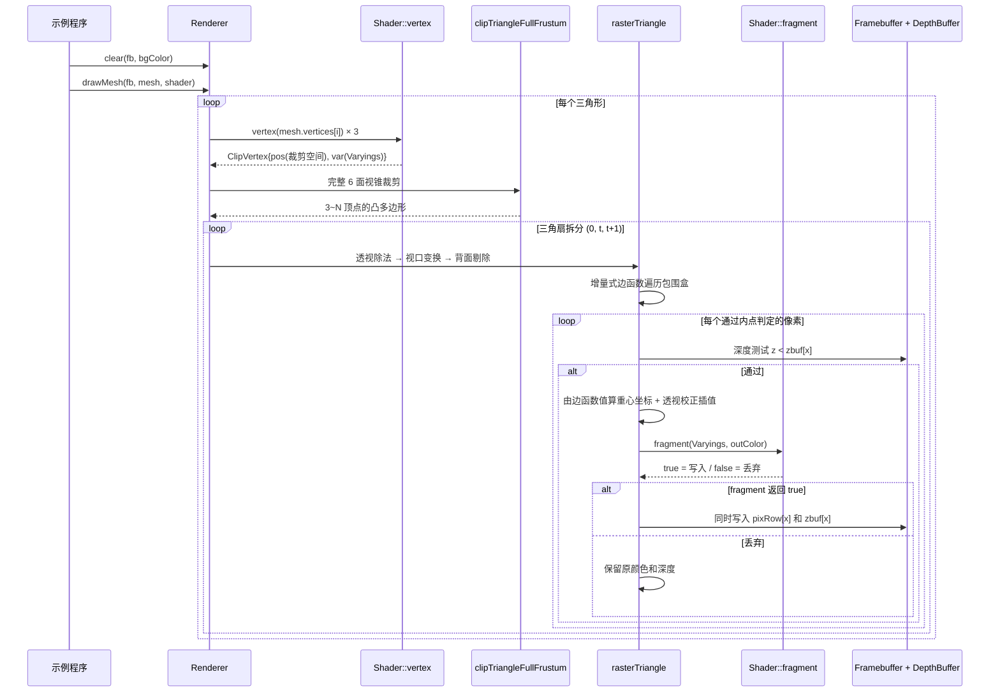
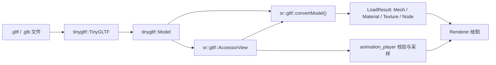
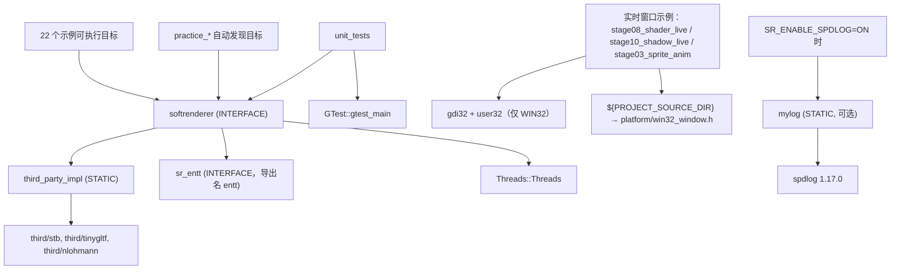

# SoftRenderer 架构

> 本文件描述模块划分、依赖方向、数据流与设计思想。
> 各模块的具体职责、输入输出与扩展点见 [`modules.md`](modules.md)。
>
> 依赖关系由实测 `src/` 全量 `#include` 扫描得出，非推测。

## 一、设计定位

SoftRenderer 是**教学型软件渲染器**，两条设计约束优先级最高：

1. **可读性优先于性能**：每个渲染阶段都要能被单独读懂，因此宁可用清晰的
   标量代码，也不做过度的模板元编程或激进的 SIMD 化。
2. **核心计算与平台后端隔离**：数学、光栅化不依赖窗口或图形 API；
   资源加载依赖 stb/tinygltf/tinyobjloader，ECS 使用 EnTT。完整库以头文件为主，
   同时链接资源实现静态库；不能将整个 `src/` 称作零第三方依赖。

这两条约束解释了项目中若干看似「不够优化」的选择，详见「六、已知架构权衡」。

覆盖与属性插值分离：`raster/coverage.h` 提供确定性的 top-left 子像素覆盖，供基础填充、Renderer、标量/SSE2 与 MSAA 共用；MSAA 示例算法提取到 `raster/msaa_renderer.h`。设计见 [ADR-003](adr/ADR-003-raster-coverage.md)，实测见[性能基线](engineering/58-覆盖规则与性能基线.md)。

## 二、分层结构

```mermaid
graph TD
    subgraph L4["使用层（平台相关，仅此处可见 Win32）"]
        EX["examples/ 22 个示例"]
        PR["practice/ 练习程序"]
        PLAT["platform/win32_window.h"]
    end

    subgraph L3["src/ 渲染器与资源层（平台无关，以头文件为主）"]
        RASTER["raster/ 光栅化与渲染器"]
        SHADER["shader/ 可编程着色管线"]
        SCENE["scene/ 场景资源与加载"]
        CORE["core/ 缓冲与基础设施"]
        MATH["math/ 数学库"]
    end

    subgraph L2["第三方（third/，源码内嵌）"]
        TGLTF["tinygltf + nlohmann/json"]
        TOBJ["tinyobjloader"]
        STB["stb_image / stb_image_write"]
        ENTT["EnTT"]
        SPDLOG["spdlog（可选）"]
    end

    EX --> RASTER
    EX --> SCENE
    EX -.仅实时窗口示例.-> PLAT
    PR --> RASTER

    RASTER --> SHADER
    RASTER --> CORE
    RASTER --> SCENE
    SHADER --> SCENE
    SHADER --> CORE
    SCENE --> CORE
    SCENE --> MATH
    CORE --> MATH

    SCENE -.gltf_loader.h / animation_player.h.-> TGLTF
    SCENE -.obj_loader.h.-> TOBJ
    CORE -.image_write.h / tga.h.-> STB
    EX -.components.h + ECS 用法.-> ENTT
    CORE -.core/log.h，仅 SR_USE_SPDLOG.-> SPDLOG
```

**分层规则（红线，见 `.qoder/rules/engineering_rules.md`）**：

- 箭头只能自上而下。`src/` 中**任何文件都不得** `#include <windows.h>` 或引用 Win32 API
- `platform/` 不属于渲染器本体，只对需要开窗的示例可见
- 虚线为**条件/局部**依赖：第三方头文件仅在少数几个头文件中出现，且多数受宏保护

## 三、模块依赖明细

实测的完整依赖边（`A -> B` 表示 A include B）：

### math/（最底层，无外部依赖）

```
vec.h          → （叶子，仅标准库）
mat4.h         → vec.h
mat3.h         → mat4.h, vec.h
quat.h         → vec.h, mat4.h
rect.h         → vec.h
transform.h    → mat4.h
transform2d.h  → mat3.h, rect.h
```

`math/` 内部**无循环依赖**，`vec.h` 是唯一叶子。

> `transform2d.h` 独立于 `transform.h`，是为了让 3D 投影（`transform.h` 只依赖 `mat4.h`）
> 不被 2D 所需的 `mat3.h` / `rect.h` 污染依赖面。

### core/（依赖 math/，可选依赖第三方）

```
color.h              → （叶子）
depthbuffer.h        → （叶子）
framebuffer.h        → color.h
blend.h              → color.h
tga.h                → framebuffer.h
image_write.h        → framebuffer.h            （实现依赖 stb_image_write）
msaa_framebuffer.h   → color.h, depthbuffer.h
float_framebuffer.h  → color.h, depthbuffer.h, framebuffer.h, math/vec.h
gbuffer.h            → math/vec.h, float_framebuffer.h
post_processing.h    → color.h, framebuffer.h, float_framebuffer.h, math/mat4.h, math/vec.h
log.h                → Logger.h（仅当定义 SR_USE_SPDLOG）
profiler.h           → （叶子）
arena.h              → （叶子）
benchmark.h          → raster/rasterizer_fast.h
resource_manager.h   → （叶子，模板 + concepts）
command_buffer.h     → （叶子，线程池）
```

> ⚠️ **`core/` 并非严格的最底层**：`gbuffer.h`、`post_processing.h`、
> `float_framebuffer.h` 都依赖 `math/`。真实最底层是 `math/` + `core/color.h` +
> `core/depthbuffer.h`。
>
> ⚠️ **`core/benchmark.h` 反向依赖 `raster/rasterizer_fast.h`**，是 `core/ → raster/`
> 的层次倒置。这是 `rasterizer_fast.h` 未被主渲染链路使用（见「六、已知架构权衡」）
> 带来的连带问题。

### scene/（依赖 core/ + math/ + 第三方加载器）

```
mesh.h             → math/vec.h
texture.h          → core/tga.h, math/vec.h
gltf_types.h       → math/vec.h, math/mat4.h, texture.h
cubemap.h          → math/vec.h, texture.h
camera.h           → math/mat3.h, math/rect.h, math/transform.h
components.h       → math/vec.h
particle_system.h  → math/vec.h, core/color.h
render_queue.h     → math/vec.h
skeleton.h         → math/mat4.h, math/vec.h
image_loader.h     → core/tga.h                   （声明 stbi_load）
obj_loader.h       → mesh.h, tiny_obj_loader.h
gltf_accessor.h    → tiny_gltf.h（非拥有字节视图）
gltf_mesh.h        → gltf_accessor.h, mesh.h
gltf_loader.h      → gltf_mesh.h, gltf_types.h, animation_player.h, tiny_gltf.h
animation_player.h → math/mat4.h, math/quat.h, math/vec.h, gltf_types.h, gltf_accessor.h
```

> ⚠️ **第三方头文件泄漏到公共接口**：`gltf_loader.h` 与 `animation_player.h` 在
> 公共头中 `#include "tiny_gltf.h"`。下游用户 include 这两个头时，必须能找到
> tinygltf 与 nlohmann/json 的头文件路径。当前由 `third_party_impl` 目标的
> `PUBLIC` include 目录解决，但这是一个**有意的泄漏**：把 `tinygltf::Model`
> 暴露给了调用方（`animation_player` 需要直接访问动画采样数据）。

### shader/（依赖 scene/ + core/）

```
shader.h            → math/mat4.h, scene/mesh.h, scene/texture.h
shaders.h           → shader.h
advanced_shaders.h  → core/depthbuffer.h, shaders.h
pbr_shader.h        → scene/cubemap.h, shader.h
```

`shader.h` 定义 `Shader` 抽象（`vertex` / `geometry` / `fragment` 三段回调）
与 `Varyings`（跨阶段插值数据），是整个可编程管线的契约中心。

### raster/（顶层，汇聚所有依赖）

```
line.h            → core/framebuffer.h
triangle.h        → core/framebuffer.h, math/vec.h, line.h
clip.h            → shader/shader.h
rasterizer_fast.h → core/depthbuffer.h, core/framebuffer.h, math/vec.h
renderer.h        → core/depthbuffer.h, core/framebuffer.h, core/profiler.h,
                    math/transform.h, clip.h, triangle.h, shader/shader.h
shape2d.h         → core/blend.h, core/framebuffer.h, math/rect.h, math/vec.h
blit2d.h          → core/blend.h, core/framebuffer.h, core/tga.h, math/mat3.h,
                    math/rect.h, shape2d.h, scene/texture.h
renderer2d.h      → core/blend.h, core/framebuffer.h, core/tga.h, math/mat3.h,
                    math/rect.h, blit2d.h, shape2d.h, scene/camera.h, scene/texture.h
```

> ⚠️ **`raster/clip.h → shader/shader.h` 造成依赖放大**：`ClipVertex` 需要内嵌
> `Varyings`，因此 include `clip.h` 会连带拉入 `scene/mesh.h` + `scene/texture.h`。
> `renderer.h` 是最大受益者也是最大受害者——它的编译依赖面覆盖了几乎整个 `src/`。

**3D 与 2D 共享底层图元**：`triangle.h` 与 `line.h` 位于全局命名空间，被
`renderer.h`（3D）与 `shape2d.h` / `blit2d.h`（2D）共同使用。这是两个子系统
唯一的交汇点，也是唯一刻意的全局符号。

## 四、核心数据流

### 3D 渲染一帧（`Renderer::drawMesh`，`src/raster/renderer.h`）



**关键实现细节**：`rasterTriangle` 的内层循环使用 `fb.row(y)` / `zbuf_.row(y)`
**行指针直写**，绕过 `setPixel` / `testAndSet` 的逐像素边界检查。安全性由包围盒
预先 clamp 到 `[0, width-1] × [0, height-1]` 保证（`renderer.h` 第 102-108 行）。
这是一个**必须保持的契约**：任何修改包围盒计算或行指针用法的改动，都要重新确认
clamp 仍然生效。

### 2D 渲染（`Renderer2D`，`src/raster/renderer2d.h`）


`plotBlend` 是 2D 子系统**唯一的像素写入出口**，统一处理：边界裁剪 → BlendMode
混合 → 可选 scissor。短路优化规则：仅 `Opaque`，或（`a == 255` 且模式为
`AlphaBlend` / `Premultiplied`）时才直接覆盖；`Additive` / `Multiply` 不短路。

文字与精灵绘制缓存 `deviceTransform`，避免逐像素做矩阵乘法。

### glTF 加载链路



加载错误不返回半成品；动画失败不修改输出；普通任务错误由 waitAll 报告，结果任务由 future::get 报告。接口生命周期与兼容性见 [ADR-002](adr/ADR-002-data-and-task-errors.md)。

### 实现单元分工（⚠ 与文件名直觉相反）

`src/` 几乎全是头文件，仅有 **1 个** `.cpp`：`src/scene/gltf_loader_impl.cpp`（9 行）。
它的作用是 `#define TINYGLTF_IMPLEMENTATION`，把 tinygltf 的符号收敛到单个编译单元。

连同 `third/` 下的两个，全部第三方实现共三个单元，都编入 `third_party_impl` 静态库：

| 实现单元 | `#define` | 提供的符号 |
| --- | --- | --- |
| `third/tinygltf/tiny_gltf_impl.cpp` | `STB_IMAGE_IMPLEMENTATION`、`STB_IMAGE_WRITE_IMPLEMENTATION` | **stb_image + stb_image_write** |
| `src/scene/gltf_loader_impl.cpp` | `TINYGLTF_IMPLEMENTATION` | **tinygltf** |
| `third/tiny_obj_loader_impl.cpp` | `TINYOBJLOADER_IMPLEMENTATION` | **tinyobjloader** |

> ⚠️ **文件名陷阱**：`tinygltf/tiny_gltf_impl.cpp` 位于 `tinygltf/` 目录、
> 名字也叫 `tiny_gltf_impl`，但它**完全不含 tinygltf 的实现**，只提供 stb。
>
> 根 `CMakeLists.txt` 原本的注释声称「tinygltf 内部会 define
> STB_IMAGE_IMPLEMENTATION，所以一个 .cpp 同时提供 stb + tinygltf 的所有符号」，
> 与实际不符，已修正。**结论：涉及第三方实现归属时，必须读 `.cpp` 源文件，
> 不能依赖文件名或既有注释推断。**

## 五、命名空间现状

`src/` 的命名空间使用**不统一**，这是当前最主要的架构债（收敛中，见 ADR-001）：

| 命名空间 | 所在文件 | 内容 |
| --- | --- | --- |
| （全局） | `framebuffer.h`、`depthbuffer.h`、`color.h`、`blend.h`、`renderer.h`、`renderer2d.h`、`triangle.h`、`clip.h`、`camera.h`、`mesh.h`、`texture.h`、`skeleton.h`、`shader.h` 等 | `Framebuffer`、`Color`、`Renderer`、`Camera`、`Texture`、`Mesh` 等 **45 个**核心类型 |
| `sr` | `arena.h`、`benchmark.h`、`log.h`、`profiler.h`、`resource_manager.h`、**`components.h`**、**`gbuffer.h`**、**`float_framebuffer.h`**、**`msaa_framebuffer.h`**、**`command_buffer.h`** | `ArenaAllocator`、`Profiler`、`ResourceManager`、`Log`、`formatLog`；**8 个 ECS 组件**；**`GBuffer`/`FloatFramebuffer`/`MSAAFramebuffer`/`kMSAA4Offsets`/`CommandBuffer`/`ThreadPool`** |
| `draw2d` | `shape2d.h`、`blit2d.h` | 全部 2D 图元与合成函数 |
| `colors` | `color.h` | 颜色常量 |
| `transform` | `transform.h`、`transform2d.h` | 投影与视口变换 |
| `tga` / `imagewriter` / `imageloader` | `tga.h` / `image_write.h` / `image_loader.h` | 图像 I/O |
| `meshgen` / `texgen` / `objloader` / `gltfloader` | `mesh.h` / `texture.h` / `obj_loader.h` / `gltf_loader.h` | 资源生成与加载 |
| `raster_fast` | `rasterizer_fast.h` | 实验性 SIMD 光栅化器 |
| `postprocess` | `post_processing.h` | 后处理合集：FXAA、DOF、径向模糊、暗角、色差、SSAO |
| `regression` | `test/pixel_regression.h` | 像素回归测试 |

### 收敛进度（ADR-001）

| 批次 | 范围 | 全局类型数 | 状态 |
| --- | --- | --- | --- |
| — | 起点 | 60 | — |
| 1 | `components.h` 的 8 个 ECS 组件 | 60 → 52 | ✅ 已完成 |
| 2 | `gbuffer.h`、`float_framebuffer.h`、`msaa_framebuffer.h`、`command_buffer.h`（6 个类型 + `kMSAA4Offsets`）；`ssao.h` 已合并入 `post_processing.h`（统一 `namespace postprocess`） | 52 → **45** | ✅ 已完成 |
| 3 | `skeleton.h`（6）、`particle_system.h`（3）、`render_queue.h`（2）、`gltf_types.h`（6）、`shader/` 具体着色器（5） | — | 待做（均低引用面，可不留别名） |
| 4 | `color.h`、`math/`、`framebuffer.h`、`depthbuffer.h`、`mesh.h`、`texture.h`、`shader.h`、`renderer.h`、`raster/` | — | 待做（高引用面，需全仓扰动） |
| 5 | 14 个全局子命名空间（`tga`/`colors`/`transform`/`draw2d`/`fxaa`/`postprocess` 等） | — | 待做（它们本身也是易撞名的全局符号） |

两批均**不留全局别名**直接完成，因为实测引用面极小。

#### 已验证的迁移手法

1. **把头文件内容包进 `namespace sr`**。内部对尚未迁移的全局类型
   （`Vec3f` / `Mat4` / `Color` / `DepthBuffer`）的引用**无需改动** ——
   `namespace sr` 内的名字查找会回落到全局作用域。这是逐文件增量迁移可行的关键。
2. **跨命名空间引用需显式引入**。例：`post_processing.h` 的 `namespace postprocess`
   仍在全局，其内部查找只回落到全局、**不会进入 `sr`**，所以需
   `using sr::FloatFramebuffer;`。用 using-**声明**而非 directive，只引入确实需要的名字。
3. **`.cpp` 应用代码可加 `using namespace sr;`**（已用于 `demo_stars.cpp`、
   `stage13_postprocess.cpp`、`stage11_msaa.cpp`）。

#### ⚠ 测试文件不能用 `using namespace sr;`（实测发现）

`tests/unit/test_core.cpp` **故意不用** using-directive，原因是实测撞上了两个冲突：

1. 全局作用域的 `struct Position` 哨兵与 using-directive 引入的 `sr::Position`
   构成 **二义性（MSVC C2872）**，而不是预期的「全局声明遮蔽 directive 名字」。
   using-directive 会把 `sr` 的成员当作**最近公共外围命名空间**（此处即全局）
   的成员参与查找，两者同级。
2. gtest 的 `TEST(GBuffer, WriteAndRead)` 会创建名为 `GBuffer` 的**命名空间**，
   与 using-directive 引入的 `sr::GBuffer` 类同名也冲突。

因此测试文件统一写显式 `sr::` 限定。

> **对后续批次的影响**：若想恢复测试文件的 using-directive 便利，应先把
> 编译期哨兵拆到单独文件（该文件不用 directive）—— 这也正好是 TASK-006
> 测试目录拆分的一部分。两者宜合并执行。

> **为何不对高冲突名字用别名桥**：`using sr::Position;` 仍然把 `Position`
> 注入全局命名空间，下游照样撞名。别名桥只是让大改动可以分批提交的工具，
> **不是对下游的兼容承诺**。完整论证见 `docs/adr/ADR-001-namespace-convergence.md`。
>
> 该结论已用**编译期哨兵**锁定：`tests/unit/test_core.cpp` 在全局作用域声明了
> 8 个同名哨兵类型（`struct Position { int canary; };` 等）。若将来有人加回
> `using sr::Position;`，测试文件会直接报重定义错误。

**已经造成过实际冲突**：`draw2d` 命名空间的引入原因，就是 2D 图元函数名
（`fillRect` / `fillCircle` / `SpritePalette`）与 `examples/` 中已有的全局同名符号
冲突。这不是理论风险。

**对下游集成方的影响**：本项目是 header-only 库。前两批完成后，
`Color`（400 处引用 / 49 文件）、`Mat4`（231 / 33）、`Framebuffer`（160 / 45）、
`Mesh`（63 / 24）、`Texture`（56 / 20）、`Animation`、`Vertex`、`Camera`、`Shader`、
`Renderer` 等 **45 个**类型仍在全局命名空间，依然会与用户代码冲突。
完整实测引用面数据与分批计划见 `docs/tasks/TASK-007-全局命名空间收敛.md`。

## 六、已知架构权衡

### 6.1 `rasterizer_fast.h` 未接入主渲染链路

`raster_fast::fillTriangleFast`（增量边函数 + SSE2 四像素并行）**从未被
`Renderer` 调用**，全仓引用只有 `core/benchmark.h` 与单元测试。

不接入的理由：

1. **像素写入路径反而更慢**：`rasterizer_fast.h` 逐像素调用
   `zb.testAndSet(x,y,z)` + `fb.setPixel(x,y,color)`，两者各做一次边界检查；
   而 `renderer.h` 用行指针直写，完全免除边界检查
2. **接口能力不足**：只接受单一 `Color`，不支持 `Varyings` 插值与
   `Shader::fragment` 回调，无法承载完整着色管线

接入需要同时改造这两点，属架构级变更，需先立 ADR。当前定位为
**技术验证 / 基准测试用光栅化器**。

### 6.2 日志双模式：内置模式已改为类型安全的变参模板

`core/log.h` 有两种模式，**占位符语法统一为 fmt 风格的 `{}`**：

| 模式 | 触发条件 | 实现 |
| --- | --- | --- |
| spdlog | 定义 `SR_USE_SPDLOG` 且链接 `mylog` | `LOGS_WARN(...)` → fmt 格式化 |
| 内置 | 默认 | `sr::formatLog`（变参模板 + `std::ostringstream`）→ 单个 `%s` 输出 |

**哪些目标走哪条路径**（CMake 中只有调了 `sr_enable_logging()` 的目标才启用 spdlog）：

| 目标 | 模式 |
| --- | --- |
| `stage08_shader_live`、`stage10_shadow_live`、全部 `practice_*` | spdlog |
| **`unit_tests`**、其余 20 个示例 | 内置 |

→ **内置模式是常用路径，不是罕见兜底**。这个事实是下面重构的依据。

#### 旧实现的三个缺陷（已修）

旧版 `sr::Log::log` 是真正的 C 可变参函数（`const char* fmt, ...` + `va_list` + `vfprintf`）：

| # | 缺陷 | 发现方式 |
| --- | --- | --- |
| 1 | 传 `std::string` 等非 POD 类型经 `...` 是**未定义行为** | TASK-003 给 `image_loader.h` 加日志时，全量构建报出 2 个 **C4840** |
| 2 | 格式串按 printf 语义解析，但约定写的是 `{}` → **占位符从不被替换**，默认构建下所有带参日志只能看到字面量 `{}`，参数全丢 | 阅读 `vfprintf` 路径时发现 |
| 3 | 日志文本里的字面 `%`（如 `"100% done"`）被 `vfprintf` 当转换符解析 → UB | 同上 |

缺陷 1 尤其反直觉：很容易误以为「内置模式只是忽略参数，无害」。
实际上非 POD 类型经 C 可变参传递本身就是 UB，与参数是否被读取无关。

#### 现实现

```cpp
namespace sr::logfmt {
    inline void appendRest(std::ostringstream& os, const char* fmt);                  // 递归终止
    template <typename T, typename... Rest>
    void appendRest(std::ostringstream& os, const char* fmt, const T& v, const Rest&...);
}

template <typename... Args>
std::string formatLog(const char* fmt, const Args&... args);   // {} 按顺序替换
inline std::string formatLog(const char* fmt);                  // 无参重载，避开 ostringstream

inline const char* levelName(LogLevel l);                       // switch，覆盖全部枚举值
```

三个设计要点：

1. **格式化逻辑拆成独立函数 `formatLog`**，而不藏在 `Log::log` 里。
   目的是可测试（`engineering_rules.md`「代码必须保留可测试入口」）：
   直接断言返回的字符串即可，无需捕获 stderr（在 Windows 上既繁琐又不稳定）。
   `Log` 测试套件因此得以存在。
2. **消息先格式化好再用单个 `%s` 输出**，所以消息文本里的字面 `%` 不会被解析（消除缺陷 3）。
3. **`levelName` 用 `switch` 而非常量数组**：旧数组 `{"TRACE",...,"CRIT "}` **漏了 `Off`**，
   一旦传 `LogLevel::Off` 就会越界读（枚举有 7 个值，数组只有 6 项）。

#### 降级语义（与 fmt 的差异）

| 情况 | fmt / spdlog | 内置 `formatLog` |
| --- | --- | --- |
| 参数多于 `{}` | 忽略多余参数 | **追加输出**（不静默丢信息） |
| `{}` 多于参数 | 抛 `fmt::format_error` | 原样保留 `{}`（降级而不崩溃） |
| `{{` / `}}` 转义 | 输出字面 `{` / `}` | **不支持**，`{}` 一律当占位符 |
| `{:>8}` 等规格 | 支持 | **不支持** |
| 浮点精度 | 可控 | `ostringstream` 默认 6 位有效数字 |

需要转义与格式规格时改用 spdlog 模式。这些差异已录入 `engineering_rules.md` 红线。

#### 为何不用 `std::format`

`std::format` 能彻底对齐 fmt 语义，但：各编译器支持度差异大（MSVC 19.29+、
GCC 13+），且本项目 `src/` 已有 C++23 基线但希望尽可能宽容；
`<sstream>` 在所有目标工具链上都可用。当前日志量极少，格式化能力差异不构成实际约束。

**失效条件**：若将来日志量变大、或需要结构化日志 / 异步刷盘，
应重新评估直接依赖 spdlog（而非维护两套实现）。

### 6.3 例外：不设 `database.md` / `protocol.md`

按 `documentation_rules.md`「若某类文档确实不适用可跳过，但需在 architecture.md 说明」：

- **无 `docs/database.md`**：本项目不持久化结构化数据，唯一的落盘输出是
  图像文件（TGA / PNG）与 Chrome Tracing JSON，格式由 stb / 标准规范定义
- **无 `docs/protocol.md`**：无网络通信。进程间唯一的数据交换是 Profiler 输出的
  Chrome Tracing JSON，遵循公开的
  [Trace Event Format](https://docs.google.com/document/d/1CvAClvFfyA5R-PhYUmn5OOQtYMH4h6I0nSsKchNAySU) 规范
- **无 `docs/deployment.md`**：本项目是可执行示例集合 + header-only 库，
  部署即「编译并运行」，构建步骤已在根 `README.md` 完整给出。
  库的安装导出规则见 `cmake/install.cmake`

## 七、构建产物拓扑



`softrenderer` 提供 `SoftRenderer::softrenderer` 别名，供外部 `find_package` 使用。
安装规则见 `cmake/install.cmake`（导出 `softrenderer` / `third_party_impl` / `entt`，
安装它们的公共头及依赖头，示例与练习不安装）。根 CMake 负责库与接口，
`examples/`、`practice/`、`tests/` 各自注册目标；作为子项目时三类目标默认关闭。
安装包消费测试还验证整体移动安装前缀后可编译并运行。

## 八、平台隔离机制

`CMakeLists.txt` 的分层注释声明：「渲染器本体永远接触不到平台代码」。
当前该约束**由人工审查保证，没有机制强制**。

实际隔离状态：

| 层 | 平台相关代码 | 隔离手段 |
| --- | --- | --- |
| `src/` | 无 | 约定 + 人工审查（**无编译期强制**） |
| `src/raster/rasterizer_fast.h` | SSE2 intrinsics | `#if defined(__SSE2__) \|\| defined(_M_X64) \|\| ...` 编译期探测，非 x86 自动降级到标量版 |
| `platform/win32_window.h` | 全部 Win32 | 整个文件包在 `#ifdef _WIN32` 内，非 Windows 平台展开为空 |
| 实时窗口示例 | 使用 `Win32Window` | `examples/CMakeLists.txt` 以 `if(WIN32)` 守卫整个目标 |

窗口目标守卫已在 TASK-004 修复，本轮拆分 CMake 时保留。跨平台运行结果必须以实际 CI 作业为准。
