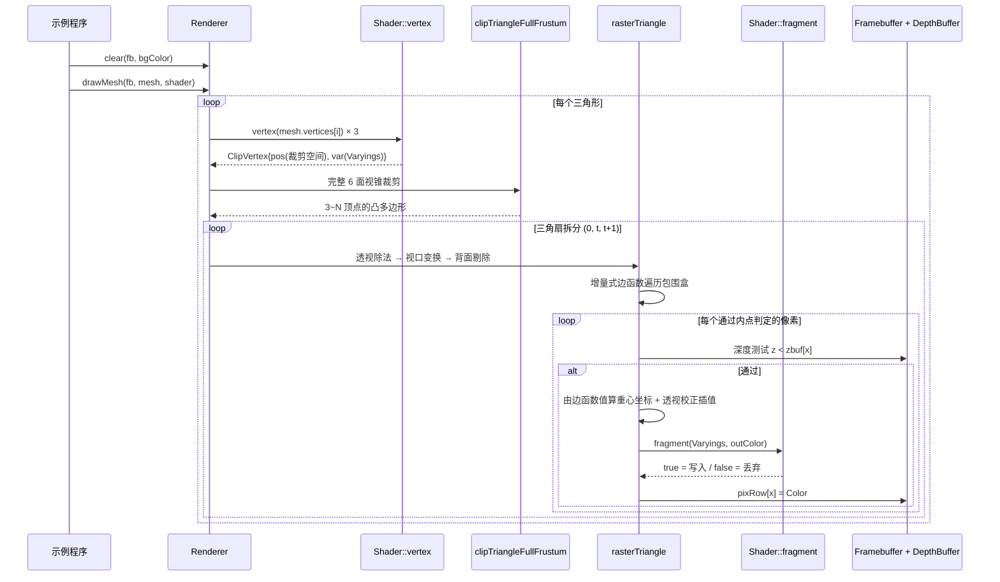
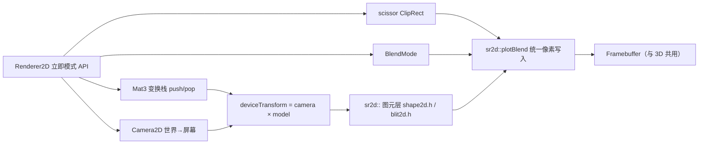
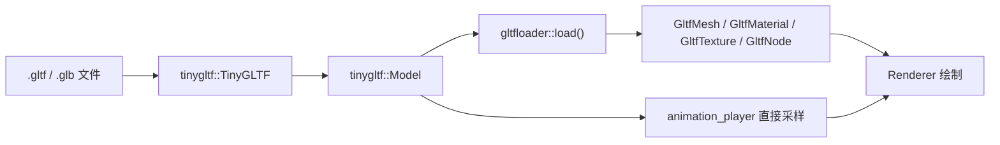
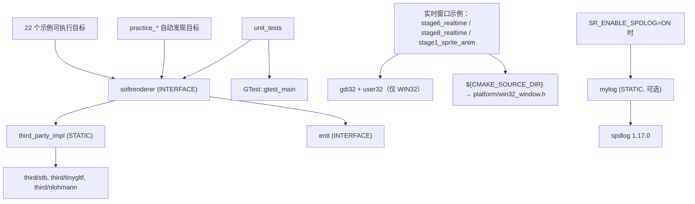

# SoftRenderer 架构

> 本文件描述模块划分、依赖方向、数据流与设计思想。
> 各模块的具体职责、输入输出与扩展点见 [`modules.md`](modules.md)。
>
> 依赖关系由实测 `src/` 全量 `#include` 扫描得出，非推测。

## 一、设计定位

SoftRenderer 是**教学型软件渲染器**，两条设计约束优先级最高：

1. **可读性优先于性能**：每个渲染阶段都要能被单独读懂，因此宁可用清晰的
   标量代码，也不做过度的模板元编程或激进的 SIMD 化。
2. **渲染器本体零平台 / 零第三方依赖**：`src/` 默认只用 C++ 标准库，
   任何 spdlog / Win32 / SSE2 依赖都通过条件编译隔离。

这两条约束解释了项目中若干看似「不够优化」的选择，详见「六、已知架构权衡」。

## 二、分层结构

```mermaid
graph TD
    subgraph L4["使用层（平台相关，仅此处可见 Win32）"]
        EX["examples/ 22 个示例"]
        PR["practice/ 练习程序"]
        PLAT["platform/win32_window.h"]
    end

    subgraph L3["src/ 渲染器本体（平台无关，纯头文件）"]
        RASTER["raster/ 光栅化与渲染器"]
        SHADER["shader/ 可编程着色管线"]
        SCENE["scene/ 场景资源与加载"]
        CORE["core/ 缓冲与基础设施"]
        MATH["math/ 数学库"]
    end

    subgraph L2["第三方（third/，源码内嵌）"]
        TGLTF["tinygltf + nlohmann/json"]
        TOBJ["tinyobjloader"]
        STB["stb_image / stb_image_write"]
        ENTT["EnTT"]
        SPDLOG["spdlog（可选）"]
    end

    EX --> RASTER
    EX --> SCENE
    EX -.仅实时窗口示例.-> PLAT
    PR --> RASTER

    RASTER --> SHADER
    RASTER --> CORE
    RASTER --> SCENE
    SHADER --> SCENE
    SHADER --> CORE
    SCENE --> CORE
    SCENE --> MATH
    CORE --> MATH

    SCENE -.gltf_loader.h / animation_player.h.-> TGLTF
    SCENE -.obj_loader.h.-> TOBJ
    CORE -.image_write.h / tga.h.-> STB
    EX -.components.h + ECS 用法.-> ENTT
    CORE -.core/log.h，仅 SR_USE_SPDLOG.-> SPDLOG
```

**分层规则（红线，见 `.qoder/rules/engineering_rules.md`）**：

- 箭头只能自上而下。`src/` 中**任何文件都不得** `#include <windows.h>` 或引用 Win32 API
- `platform/` 不属于渲染器本体，只对需要开窗的示例可见
- 虚线为**条件/局部**依赖：第三方头文件仅在少数几个头文件中出现，且多数受宏保护

## 三、模块依赖明细

实测的完整依赖边（`A -> B` 表示 A include B）：

### math/（最底层，无外部依赖）

```
vec.h          → （叶子，仅标准库）
mat4.h         → vec.h
mat3.h         → mat4.h, vec.h
quat.h         → vec.h, mat4.h
rect.h         → vec.h
transform.h    → mat4.h
transform2d.h  → mat3.h, rect.h
```

`math/` 内部**无循环依赖**，`vec.h` 是唯一叶子。

> `transform2d.h` 独立于 `transform.h`，是为了让 3D 投影（`transform.h` 只依赖 `mat4.h`）
> 不被 2D 所需的 `mat3.h` / `rect.h` 污染依赖面。

### core/（依赖 math/，可选依赖第三方）

```
color.h              → （叶子）
depthbuffer.h        → （叶子）
framebuffer.h        → color.h
blend.h              → color.h
tga.h                → framebuffer.h
image_write.h        → framebuffer.h            （实现依赖 stb_image_write）
fxaa.h               → color.h, framebuffer.h
msaa_framebuffer.h   → color.h, depthbuffer.h
float_framebuffer.h  → color.h, depthbuffer.h, framebuffer.h, math/vec.h
gbuffer.h            → math/vec.h, float_framebuffer.h
post_effects.h       → float_framebuffer.h, math/vec.h
ssao.h               → math/mat4.h, math/vec.h
log.h                → Logger.h（仅当定义 SR_USE_SPDLOG）
profiler.h           → （叶子）
arena.h              → （叶子）
benchmark.h          → raster/rasterizer_fast.h
resource_manager.h   → （叶子，模板 + concepts）
command_buffer.h     → （叶子，线程池）
```

> ⚠️ **`core/` 并非严格的最底层**：`gbuffer.h`、`post_effects.h`、`ssao.h`、
> `float_framebuffer.h` 都依赖 `math/`。真实最底层是 `math/` + `core/color.h` +
> `core/depthbuffer.h`。
>
> ⚠️ **`core/benchmark.h` 反向依赖 `raster/rasterizer_fast.h`**，是 `core/ → raster/`
> 的层次倒置。这是 `rasterizer_fast.h` 未被主渲染链路使用（见「六、已知架构权衡」）
> 带来的连带问题。

### scene/（依赖 core/ + math/ + 第三方加载器）

```
mesh.h             → math/vec.h
texture.h          → core/tga.h, math/vec.h
gltf_types.h       → math/vec.h, texture.h
cubemap.h          → math/vec.h, texture.h
camera.h           → math/mat3.h, math/rect.h, math/transform.h
components.h       → math/vec.h
particle_system.h  → math/vec.h, core/color.h
render_queue.h     → math/vec.h
skeleton.h         → math/mat4.h, math/vec.h
image_loader.h     → core/tga.h                   （声明 stbi_load）
obj_loader.h       → mesh.h, tiny_obj_loader.h
gltf_loader.h      → math/vec.h, gltf_types.h, mesh.h, tiny_gltf.h
animation_player.h → math/mat4.h, math/quat.h, math/vec.h, gltf_types.h, tiny_gltf.h
```

> ⚠️ **第三方头文件泄漏到公共接口**：`gltf_loader.h` 与 `animation_player.h` 在
> 公共头中 `#include "tiny_gltf.h"`。下游用户 include 这两个头时，必须能找到
> tinygltf 与 nlohmann/json 的头文件路径。当前由 `third_party_impl` 目标的
> `PUBLIC` include 目录解决，但这是一个**有意的泄漏**：把 `tinygltf::Model`
> 暴露给了调用方（`animation_player` 需要直接访问动画采样数据）。

### shader/（依赖 scene/ + core/）

```
shader.h            → math/mat4.h, scene/mesh.h, scene/texture.h
shaders.h           → shader.h
advanced_shaders.h  → core/depthbuffer.h, shaders.h
pbr_shader.h        → scene/cubemap.h, shader.h
```

`shader.h` 定义 `Shader` 抽象（`vertex` / `geometry` / `fragment` 三段回调）
与 `Varyings`（跨阶段插值数据），是整个可编程管线的契约中心。

### raster/（顶层，汇聚所有依赖）

```
line.h            → core/framebuffer.h
triangle.h        → core/framebuffer.h, math/vec.h, line.h
clip.h            → shader/shader.h
rasterizer_fast.h → core/depthbuffer.h, core/framebuffer.h, math/vec.h
renderer.h        → core/depthbuffer.h, core/framebuffer.h, core/profiler.h,
                    math/transform.h, clip.h, triangle.h, shader/shader.h
shape2d.h         → core/blend.h, core/framebuffer.h, math/rect.h, math/vec.h
blit2d.h          → core/blend.h, core/framebuffer.h, core/tga.h, math/mat3.h,
                    math/rect.h, shape2d.h, scene/texture.h
renderer2d.h      → core/blend.h, core/framebuffer.h, core/tga.h, math/mat3.h,
                    math/rect.h, blit2d.h, shape2d.h, scene/camera.h, scene/texture.h
```

> ⚠️ **`raster/clip.h → shader/shader.h` 造成依赖放大**：`ClipVertex` 需要内嵌
> `Varyings`，因此 include `clip.h` 会连带拉入 `scene/mesh.h` + `scene/texture.h`。
> `renderer.h` 是最大受益者也是最大受害者——它的编译依赖面覆盖了几乎整个 `src/`。

**3D 与 2D 共享底层图元**：`triangle.h` 与 `line.h` 位于全局命名空间，被
`renderer.h`（3D）与 `shape2d.h` / `blit2d.h`（2D）共同使用。这是两个子系统
唯一的交汇点，也是唯一刻意的全局符号。

## 四、核心数据流

### 3D 渲染一帧（`Renderer::drawMesh`，`src/raster/renderer.h`）



**关键实现细节**：`rasterTriangle` 的内层循环使用 `fb.row(y)` / `zbuf_.row(y)`
**行指针直写**，绕过 `setPixel` / `testAndSet` 的逐像素边界检查。安全性由包围盒
预先 clamp 到 `[0, width-1] × [0, height-1]` 保证（`renderer.h` 第 102-108 行）。
这是一个**必须保持的契约**：任何修改包围盒计算或行指针用法的改动，都要重新确认
clamp 仍然生效。

### 2D 渲染（`Renderer2D`，`src/raster/renderer2d.h`）



`plotBlend` 是 2D 子系统**唯一的像素写入出口**，统一处理：边界裁剪 → BlendMode
混合 → 可选 scissor。短路优化规则：仅 `Opaque`，或（`a == 255` 且模式为
`AlphaBlend` / `Premultiplied`）时才直接覆盖；`Additive` / `Multiply` 不短路。

文字与精灵绘制缓存 `deviceTransform`，避免逐像素做矩阵乘法。

### glTF 加载链路



`src/scene/gltf_loader_impl.cpp` 是**唯一的 .cpp 实现单元**（5 行），作用是把
tinygltf 的 `#define ..._IMPLEMENTATION` 收敛到单个编译单元，避免 header-only
库在多处 include 时产生符号重定义。

## 五、命名空间现状

`src/` 的命名空间使用**不统一**，这是当前最主要的架构债：

| 命名空间 | 所在文件 | 内容 |
|---|---|---|
| （全局） | `framebuffer.h`、`depthbuffer.h`、`color.h`、`blend.h`、`renderer.h`、`renderer2d.h`、`triangle.h`、`line.h`、`clip.h`、`camera.h`、`components.h`、`mesh.h`、`texture.h`、`skeleton.h`、`shader.h` 等约 30 个文件 | `Framebuffer`、`Color`、`Renderer`、`Camera`、`Position`、`Light`、`Texture`、`Mesh` 等核心类型 |
| `sr` | `arena.h`、`benchmark.h`、`log.h`、`profiler.h`、`resource_manager.h` | `ArenaAllocator`、`Profiler`、`ResourceManager`、`Log` |
| `sr2d` | `shape2d.h`、`blit2d.h` | 全部 2D 图元与合成函数 |
| `colors` | `color.h` | 颜色常量 |
| `transform` | `transform.h`、`transform2d.h` | 投影与视口变换 |
| `tga` / `imagewriter` / `imageloader` | `tga.h` / `image_write.h` / `image_loader.h` | 图像 I/O |
| `meshgen` / `texgen` / `objloader` / `gltfloader` | `mesh.h` / `texture.h` / `obj_loader.h` / `gltf_loader.h` | 资源生成与加载 |
| `raster_fast` | `rasterizer_fast.h` | 实验性 SIMD 光栅化器 |
| `fxaa` / `postprocess` / `regression` | `fxaa.h` / `post_effects.h` / `test/pixel_regression.h` | 后处理与测试 |

**已经造成实际冲突**：`sr2d` 命名空间的引入原因，就是 2D 图元函数名
（`fillRect` / `fillCircle` / `SpritePalette`）与 `examples/` 中已有的全局同名符号
冲突。这不是理论风险。

**对下游集成方的影响**：本项目是 header-only 库，`Position`、`Scale`、`Rotation`、
`Light`、`Animation`、`Texture`、`Mesh`、`Vertex`、`Color`、`Camera` 这些全局名字
几乎必然与用户自己的代码冲突。

收敛计划见 `docs/tasks/` 中的对应 TASK 与 `docs/adr/`。

## 六、已知架构权衡

### 6.1 `rasterizer_fast.h` 未接入主渲染链路

`raster_fast::fillTriangleFast`（增量边函数 + SSE2 四像素并行）**从未被
`Renderer` 调用**，全仓引用只有 `core/benchmark.h` 与单元测试。

不接入的理由：

1. **像素写入路径反而更慢**：`rasterizer_fast.h` 逐像素调用
   `zb.testAndSet(x,y,z)` + `fb.setPixel(x,y,color)`，两者各做一次边界检查；
   而 `renderer.h` 用行指针直写，完全免除边界检查
2. **接口能力不足**：只接受单一 `Color`，不支持 `Varyings` 插值与
   `Shader::fragment` 回调，无法承载完整着色管线

接入需要同时改造这两点，属架构级变更，需先立 ADR。当前定位为
**技术验证 / 基准测试用光栅化器**。

### 6.2 日志双模式格式不兼容

`core/log.h` 有两种模式，**格式字符串语义不同**：

| 模式 | 触发条件 | 格式风格 |
|---|---|---|
| spdlog | 定义 `SR_USE_SPDLOG` 且链接 `mylog` | fmt 风格 `{}` 占位符 |
| 内置极简 | 默认 | printf 风格 `%d` / `%s` |

后果：用 `{}` 写的日志语句在默认模式下**不会替换参数**（静默输出字面量 `{}`），
反之亦然。`core/log.h` 第 91-92 行的注释已声明此限制。

选择理由：渲染器本体内部日志极少，且两种模式不会同时编译；换取的是
`src/` 默认零第三方依赖。

### 6.3 例外：不设 `database.md` / `protocol.md`

按 `documentation_rules.md`「若某类文档确实不适用可跳过，但需在 architecture.md 说明」：

- **无 `docs/database.md`**：本项目不持久化结构化数据，唯一的落盘输出是
  图像文件（TGA / PNG）与 Chrome Tracing JSON，格式由 stb / 标准规范定义
- **无 `docs/protocol.md`**：无网络通信。进程间唯一的数据交换是 Profiler 输出的
  Chrome Tracing JSON，遵循公开的
  [Trace Event Format](https://docs.google.com/document/d/1CvAClvFfyA5R-PhYUmn5OOQtYMH4h6I0nSsKchNAySU) 规范
- **无 `docs/deployment.md`**：本项目是可执行示例集合 + header-only 库，
  部署即「编译并运行」，构建步骤已在根 `README.md` 完整给出。
  库的安装导出规则见 `cmake/install.cmake`

## 七、构建产物拓扑



`softrenderer` 提供 `SoftRenderer::softrenderer` 别名，供外部 `find_package` 使用。
安装规则见 `cmake/install.cmake`（只安装 `softrenderer` / `third_party_impl` / `entt`，
示例与练习目标不参与安装）。

## 八、平台隔离机制

`CMakeLists.txt` 的分层注释声明：「渲染器本体永远接触不到平台代码」。
当前该约束**由人工审查保证，没有机制强制**。

实际隔离状态：

| 层 | 平台相关代码 | 隔离手段 |
|---|---|---|
| `src/` | 无 | 约定 + 人工审查（**无编译期强制**） |
| `src/raster/rasterizer_fast.h` | SSE2 intrinsics | `#if defined(__SSE2__) \|\| defined(_M_X64) \|\| ...` 编译期探测，非 x86 自动降级到标量版 |
| `platform/win32_window.h` | 全部 Win32 | 整个文件包在 `#ifdef _WIN32` 内，非 Windows 平台展开为空 |
| 实时窗口示例 | 使用 `Win32Window` | **无守卫** —— 非 Windows 平台会编译失败 |

⚠️ 最后一行是 CI 跨平台失败的根因，修复方案见 `docs/tasks/` 对应 TASK。
