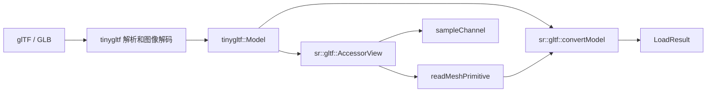

# 11 · glTF 加载与 PBR 材质

> glTF 是 Khronos 定义的 3D 场景传输格式（"3D 的 JPEG"）。本篇覆盖从文件解析到 Mesh/材质/纹理/动画转换的完整管线、支持范围与错误契约，以及 PBR 材质字段如何映射到内部结构。

## 一、为什么用 glTF

- **行业标准**：Blender/Maya/Unity/Unreal 都支持导出
- **完整场景**：网格+材质+骨骼+动画+相机+灯光
- **二进制格式**：.glb 单文件，加载快
- **PBR 材质**：metallic-roughness 工作流原生支持

依赖 tinygltf（解析）+ nlohmann/json + stb_image（纹理），三者统一编译在 `third_party_impl` 库中。

## 二、数据路径

文件入口保持 `gltfloader::load(path)` 和 `loadFirstMesh(path, out)`。
新入口 `sr::gltf::convertModel(model)` 可直接转换已解析的 tinygltf 模型，也让内存测试无需临时文件。



`AccessorView` 校验下标链、字节范围、对齐、stride 与分量类型；逐分量读取小端数据，不将字节缓冲强转成 float 指针。
它不拥有模型，创建之后模型和缓冲必须保持存活、不可修改。范围检查使用减法和除法，避免长度乘法溢出。

## 三、使用与错误

```cpp
#include <softrenderer/scene/gltf_loader.h>

auto result = gltfloader::load("model.glb");
if (!result.success) {
    report(result.error);
    return;
}
for (const auto& mesh : result.meshes) {
    renderer.drawMesh(fb, mesh, shader);
}
```

返回失败时资源集合为空，不发布部分成功的模型。`loadFirstMesh` 失败时保留调用者原有 Mesh。
分配失败仍遵循标准库异常语义。`LoadResult` 可移动、不可拷贝：材质纹理指针指向结果持有的 textures，
移动不使指针失效；调用者不能随后重分配该公开纹理容器。

## 四、支持范围

| 数据 | 当前支持 |
| --- | --- |
| 网格拓扑 | TRIANGLES；无索引时每三个顶点一组 |
| POSITION / NORMAL | FLOAT VEC3；缺少法线时从有效三角形计算 |
| TEXCOORD_0 | FLOAT 或归一化 UBYTE/USHORT VEC2 |
| 顶点布局 | 紧密/交错读取；顶点偏移与 stride 满足四字节对齐 |
| 索引 | SCALAR UBYTE/USHORT/UINT；校验数量和每个顶点索引 |
| 通用视图 | SCALAR、VEC2/3/4、FLOAT MAT4；后者按 glTF 列主序分量读取 |
| 纹理 | tinygltf 已解码的 8-bit、1–4 通道像素；见第六节 |
| 动画 | TRS 的 Linear、Step、CubicSpline；见[骨骼动画与蒙皮](../guide/34-骨骼动画与蒙皮.md) |
| sparse、无 bufferView、MAT2/MAT3 | 显式返回不支持，不默认解释为连续 float |

不声称完整 glTF 一致性：形变目标、压缩扩展、场景层级求值、完整 skin 导入和 glTF sampler 状态仍未整合。
未使用的属性不会自动成为渲染能力；节点 mesh 编号也不能直接当作已扁平化的 primitive 编号使用。
没有网格的模型返回失败。数据布局依据 [Khronos glTF 2.0 规范](https://registry.khronos.org/glTF/specs/2.0/glTF-2.0.html)。

## 五、PBR 材质解析

| glTF 字段 | 内部结构 | 说明 |
|---|---|---|
| `baseColorFactor` | `GltfMaterial::baseColorFactor` | RGB 基色乘数 |
| `metallicFactor` | `GltfMaterial::metallicFactor` | 金属度 [0,1] |
| `roughnessFactor` | `GltfMaterial::roughnessFactor` | 粗糙度 [0,1] |
| `baseColorTexture` | `baseColorTextureIndex` | 基色纹理 |
| `metallicRoughnessTexture` | `metallicRoughnessTextureIndex` | 金属度/粗糙度纹理 |
| `normalTexture` | `normalTextureIndex` | 法线贴图 |
| `emissiveFactor` | `GltfMaterial::emissiveFactor` | 自发光颜色 |
| `alphaMode` | `AlphaMode::Opaque/Mask/Blend` | 透明模式 |
| `doubleSided` | `GltfMaterial::doubleSided` | 双面渲染 |

场景图字段：`nodes[]` → `GltfNode`（TRS + mesh 引用），`node.matrix` 直接矩阵覆盖 TRS。

```cpp
auto result = gltfloader::load("model.glb");
for (size_t i = 0; i < result.meshes.size(); ++i) {
    int matIdx = result.meshMaterialIndices[i];
    // -1 表示没有显式材质，应使用调用方默认材质。
    GltfMaterial fallback;
    const auto& mat = matIdx >= 0 ? result.materials[size_t(matIdx)] : fallback;
    pbrShader.baseColor = mat.baseColorFactor;
    pbrShader.metallic = mat.metallicFactor;
    pbrShader.roughness = mat.roughnessFactor;
    renderer.drawMesh(fb, result.meshes[i], pbrShader);
}
```

参数解析不代表 shader 自动应用全部材质特性；透明度、颜色空间及完整 PBR 材质整合仍需逐项验证。

## 六、纹理加载与所有权

引用链是 material → texture → image。默认 tinygltf 图像回调已经通过 stb_image 解码 `image.image`，
其中是像素而不是 PNG/JPEG 文件字节，不能再次传入 `stbi_load_from_memory`。

1. tinygltf 从文件或内嵌内容解码图像。
2. `convertModel` 校验 source、尺寸、通道、分量位数及像素长度。
3. 将 8-bit 灰度、灰度+alpha、RGB 或 RGBA 转为内部 `Color`；`Texture` 创建 mipmap。
4. 在完整纹理数组建立后，将材质指针连接到 `LoadResult` 自有纹理。

| 字段 | 当前连接 |
| --- | --- |
| baseColorTexture | 保存索引并设置 baseColorTexture 指针 |
| metallicRoughnessTexture | 保存索引并设置 metallicRoughnessTexture 指针 |
| normalTexture | 保存索引并设置 normalTexture 指针 |
| emissiveTexture | 仅保存索引，尚未接入纹理指针/着色链路 |

目前不支持 16-bit/HDR 图像输入到该 glTF 路径，也没有应用 glTF sampler 的 wrap/filter 配置。
损坏或不支持的纹理使整体转换失败并提供 error，不返回带无效纹理的成功模型。
回归测试 `GltfTextureSafety` 验证解码像素数值、截断拒绝和移动后材质指针。

## 七、文件与迁移

| 文件 | 职责 |
| --- | --- |
| `src/io/gltf_accessor.h` | 非拥有、受校验的分量读取 |
| `src/io/gltf_mesh.h` | 类型/数量/索引校验与 Mesh 转换 |
| `include/softrenderer/io/gltf_loader.h` | 文件入口、材质/纹理/节点/动画转换 |
| `include/softrenderer/scene/scene_asset.h` | `GltfMaterial`、`GltfNode`、`GltfAnimation` 等类型 |
| `src/io/tinygltf_impl.cpp` | tinygltf 实现，链接 `third_party_impl` |
| `tests/unit/gltf_test.cpp` | 畸形输入、stride、索引和解码纹理测试 |
| `examples/demo_pbr_material.cpp` | PBR 材质渲染 demo |

旧 `accessorFloats` 已删除，迁移为 `AccessorView::create` 后调用 `readFloat` 或 `readUnsigned`，并处理失败状态。
公开头中使用 tinygltf；通过 `SoftRenderer::softrenderer` 链接会传递所需头文件和实现库。
