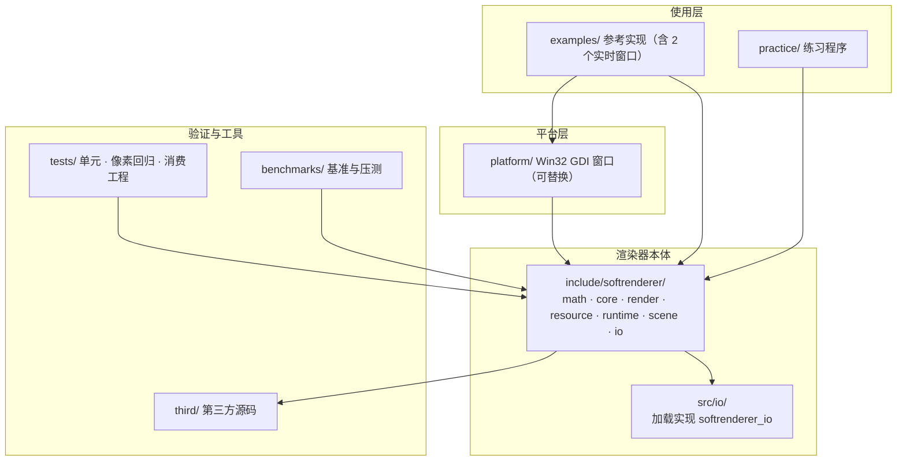

# 21 · 项目架构总览与进阶路线

> 本篇是收尾：回顾整个项目的分层架构，列出当前已实现的全部能力，并给出通向"企业级渲染引擎"的进阶路线。

## 一、分层架构

分层依赖方向从上到下；详细依赖明细与不变量见[架构文档](../architecture.md)。

## 二、已实现能力清单

| 类别 | 能力 |
|---|---|
| 数学 | Vec2/3/4, Mat3, Mat4, Quat, Rect2, dot, cross, cross2, inverse, transpose, SLERP/NLERP |
| 变换 | Model/View/Projection/Viewport, lookAt, perspective, ortho, ortho2D, viewport2D |
| 光栅化 | Bresenham 画线, 边函数+重心坐标三角形填充, 整数子像素覆盖（top-left 规则） |
| 深度 | Z-buffer, 背面剔除, discard 不写入深度 |
| 纹理 | 最近邻/双线性/三线性, mipmap 链, Repeat 环绕 |
| 插值 | 透视校正 (1/w) |
| 着色 | Flat/Gouraud/Phong, Blinn-Phong, PBR (Cook-Torrance) |
| 阴影 | Shadow Mapping + PCF 3×3 |
| 法线贴图 | TBN 切线空间 |
| 裁剪 | 完整 6 面 Sutherland-Hodgman（含顺时针绕序修复） |
| 抗锯齿 | 4x MSAA, FXAA |
| 后处理 | HDR 浮点缓冲, Bloom, ACES 色调映射, Gamma, 景深, 运动模糊, 暗角, 色差 |
| 全局光照近似 | SSAO |
| 环境光照 | IBL（Cubemap + 半球采样辐照度 + 按粗糙度选 mip 层的反射近似） |
| 延迟渲染 | G-Buffer 多渲染目标 |
| 并行 | 多线程水平分条光栅化, 命令缓冲 + 线程池 |
| 渲染管理 | RenderQueue（层→距离→材质排序）, Alpha 混合（straight / premultiplied） |
| 模型加载 | OBJ 解析（v/vt/vn/f，三角扇拆分）, glTF 2.0/glb（含 PBR 材质、动画、蒙皮） |
| 网格生成 | 立方体、球、平面、细分地面 |
| 切线计算 | Gram-Schmidt 正交化 |
| 骨骼动画 | 骨骼层级、顶点蒙皮、CubicSpline 插值、动画采样 |
| 粒子系统 | Billboard 发射器 + 重力 + 颜色渐变 |
| ECS | EnTT 组件系统（8 个组件迁入 `namespace sr`） |
| 2D 子系统 | 矢量图元（draw2d）、图像合成（blit）、Renderer2D 立即模式、变换栈、scissor、5×7 点阵字体 |
| 资源管理 | 引用计数缓存 + C++20 concepts 约束 |
| 内存管理 | Arena 线性内存池（对齐校验、reset 复用、RAII 块管理） |
| 性能分析 | Chrome Tracing Profiler、内置基准框架 |
| 测试 | GoogleTest 280 用例 / 64 套件, 3 场景像素回归, 105 个压测场景（`benchmarks/stress/`）, 下游消费工程验证, Debug ASAN |
| CI | GitHub Actions 三平台（Windows / Ubuntu / macOS）, ASAN + UBSAN + TSAN |
| 窗口 | Win32 GDI（可替换） |
| 文档 | 系统学习文档（pipeline / math / advanced / engineering）+ 4 篇 ADR |

## 三、进阶路线（通向企业级）

以下是从"教学渲染器"到"生产级引擎"的典型差距，按优先级排列：

### 性能
- [ ] **AVX2 光栅化**：在 SSE2 基础上扩展到 8 像素并行
- [ ] **Tile-based 渲染**：把屏幕分成 16×16 tile，每 tile 独立光栅化+深度，缓存友好
- [ ] **Early-Z**：深度测试提前到片元着色之前
- [ ] **顶点缓存**：对不变网格跳过顶点着色阶段

### 功能
- [ ] **级联阴影贴图（CSM）**：大场景分多级 shadow map
- [ ] **体积光 / God Rays**：径向模糊近似光柱
- [ ] **屏幕空间反射（SSR）**：基于深度缓冲的反射近似
- [ ] **GPU 后端**：把 Renderer 接口对接 Vulkan / Metal / D3D12

### 工程
- [ ] **热重载 Shader**：文件监听 + 重编译
- [ ] **异步资源加载**：后台线程加载模型/纹理，主线程无阻塞
- [ ] **场景序列化**：registry 快照保存/恢复
- [ ] **覆盖率**：接入 llvm-cov / gcov，核心模块行覆盖率 ≥ 80%

### 质量
- [ ] **SSIM 像素回归**：比逐像素差更符合人眼感知
- [ ] **模糊测试**：随机生成三角形/矩阵，验证不崩溃、不 NaN
- [ ] **clang-tidy 全仓扫描**：建立静态分析基线
- [ ] **跨平台像素基准**：每个 OS 维护自己的 golden 集

## 四、开源参考

| 项目 | 学什么 |
|---|---|
| [tinyrenderer](https://github.com/ssloy/tinyrenderer) | 极简光栅化入门 |
| [Mesa llvmpipe](https://gitlab.freedesktop.org/mesa/mesa) | 工业级 CPU 光栅化 + SIMD |
| [bgfx](https://github.com/bkaradzic/bgfx) | 跨平台渲染抽象层 |
| [Filament](https://github.com/google/filament) | PBR + 移动端优化 |
| [LearnOpenGL](https://learnopengl.com/) | GPU API 教程（对照理解管线） |
| [Real-Time Rendering 4th](https://www.realtimerendering.com/) | 理论圣经 |

## 五、结语

从一行 `setPixel` 到 PBR + 阴影 + SSAO + IBL + 多线程 + 骨骼动画 + 280 个单元测试，你已经亲手走过了实时渲染管线的每一个环节。这不是"调 API"能给你的理解——你**造过轮子**，所以你知道轮子为什么是圆的。

接下来，无论是继续深挖 CPU 渲染的性能极限，还是切到 GPU API 做产品级引擎，你都有了最坚实的底层认知。

祝渲染愉快。

---

上一篇：[20 · 单元测试与工程质量](20-单元测试与工程质量.md)
