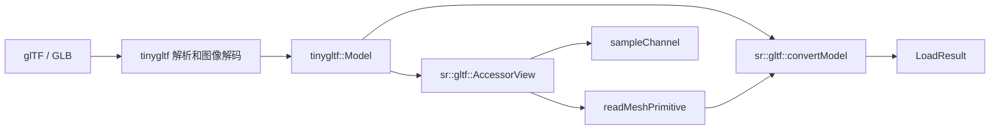

# 50 · glTF 加载管线

文件入口保持 `gltfloader::load(path)` 和 `loadFirstMesh(path, out)`。
新入口 `sr::gltf::convertModel(model)` 可直接转换已解析的 tinygltf 模型，也让内存测试无需临时文件。

## 数据路径



AccessorView 校验下标链、字节范围、对齐、stride 与分量类型；逐分量读取小端数据，不将字节缓冲强转成 float 指针。
它不拥有模型，创建之后模型和缓冲必须保持存活、不可修改。范围检查使用减法和除法，避免长度乘法溢出。

## 使用与错误

```cpp
#include "scene/gltf_loader.h"

auto result = gltfloader::load("model.glb");
if (!result.success) {
    report(result.error);
    return;
}
for (const auto& mesh : result.meshes) {
    renderer.drawMesh(fb, mesh, shader);
}
```

返回失败时资源集合为空，不发布部分成功的模型。`loadFirstMesh` 失败时保留调用者原有 Mesh。
分配失败仍遵循标准库异常语义。`LoadResult` 可移动、不可拷贝：材质纹理指针指向结果持有的 textures，
移动不使指针失效；调用者不能随后重分配该公开纹理容器。

## 支持范围

| 数据 | 当前支持 |
| --- | --- |
| 网格拓扑 | TRIANGLES；无索引时每三个顶点一组 |
| POSITION / NORMAL | FLOAT VEC3；缺少法线时从有效三角形计算 |
| TEXCOORD_0 | FLOAT 或归一化 UBYTE/USHORT VEC2 |
| 顶点布局 | 紧密/交错读取；顶点偏移与 stride 满足四字节对齐 |
| 索引 | SCALAR UBYTE/USHORT/UINT；校验数量和每个顶点索引 |
| 通用视图 | SCALAR、VEC2/3/4、FLOAT MAT4；后者按 glTF 列主序分量读取 |
| 纹理 | tinygltf 已解码的 8-bit、1–4 通道像素；详见[纹理加载](../advanced/56-glTF纹理加载.md) |
| 动画 | TRS 的 Linear、Step、CubicSpline；详见[动画播放](../advanced/57-骨骼动画播放.md) |
| sparse、无 bufferView、MAT2/MAT3 | 显式返回不支持，不默认解释为连续 float |

不声称完整 glTF 一致性：形变目标、压缩扩展、场景层级求值、完整 skin 导入和 glTF sampler 状态仍未整合。
未使用的属性不会自动成为渲染能力；节点 mesh 编号也不能直接当作已扁平化的 primitive 编号使用。
没有网格的模型返回失败。本轮没有修改这一既有加载用途。

数据布局依据 [Khronos glTF 2.0 规范](https://registry.khronos.org/glTF/specs/2.0/glTF-2.0.html)。

## 文件与迁移

| 文件 | 职责 |
| --- | --- |
| `src/scene/gltf_accessor.h` | 非拥有、受校验的分量读取 |
| `src/scene/gltf_mesh.h` | 类型/数量/索引校验与 Mesh 转换 |
| `src/scene/gltf_loader.h` | 文件入口、材质/纹理/节点/动画转换 |
| `src/scene/gltf_loader_impl.cpp` | tinygltf 实现，链接 third_party_impl |
| `tests/unit/gltf_test.cpp` | 畸形输入、stride、索引和解码纹理测试 |

旧 `accessorFloats` 已删除，迁移为 `AccessorView::create` 后调用 `readFloat` 或 `readUnsigned`，并处理失败状态。
公开头中使用 tinygltf；通过 `SoftRenderer::softrenderer` 链接会传递所需头文件和实现库。

上一篇：[49 · Chrome Tracing Profiler](49-Chrome-Tracing-Profiler.md)
下一篇：[51 · 代码规范与 clang-format](51-代码规范与clang-format.md)
